# Turbopump

Turbopump es una aplicación libre y multiplataforma (Windows, macOS y Linux), escrita en
Rust, para el diseño preliminar e interactivo de turbomáquinas: bombas, ventiladores,
compresores y turbinas.

> **Estado:** fases 0 a 5 y 7 hechas; la 6 (el resto de máquinas) queda pendiente.
> Turbopump diseña una bomba centrífuga completa, con rodete, difusor con o sin álabes y
> voluta, desde el punto de diseño hasta los sólidos CAD (STEP, IGES, STL). Da además la
> curva característica prevista, el flujo potencial meridional y las velocidades en las
> caras del álabe, con interfaz gráfica y línea de comandos. El editor del meridiano
> dibuja el canal, el material del cubo y de la tapa y las cámaras laterales, y de ahí
> sale un único dominio fluido para CFD. La hoja de ruta completa está
> en [PLAN.md](PLAN.md).

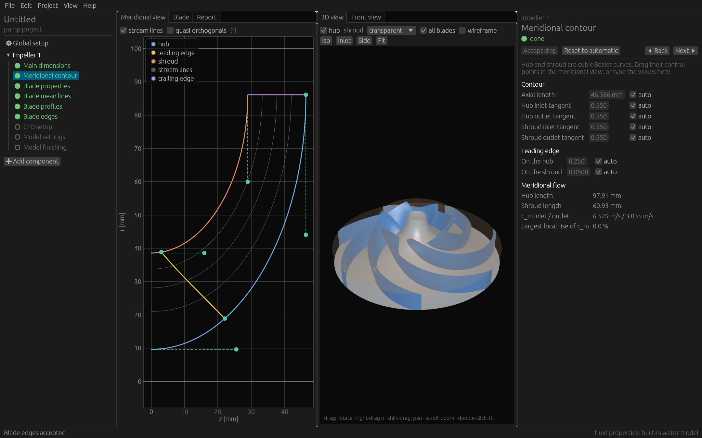

## Qué hay ahora

| Crate | Contenido |
|---|---|
| [`tp-units`](crates/tp-units) | Magnitudes físicas, unidades SI/US, conversión y lectura de texto (`"2900 rpm"`), y velocidad específica (nq, ns US, ωs, σ de Cordier) |
| [`tp-math`](crates/tp-math) | Curvas Bézier y B-spline (evaluación, derivadas, subdivisión, interpolación, inserción de nudos y paso a tramos Bézier), polilíneas, interpolación 1D monótona, raíces, cuadratura y sistemas dispersos con gradiente conjugado |
| [`tp-fluids`](crates/tp-fluids) | Propiedades de líquidos con CoolProp, cargado al ejecutar, y un modelo propio del agua (IAPWS) para cuando falta |
| [`tp-design`](crates/tp-design) | Triángulos de velocidad, deslizamiento (Wiesner), correlaciones de bomba, dimensiones principales y geometría del rodete (contorno meridional por paredes o por línea media, material del cubo y de la tapa, cámaras laterales, flujo meridional, álabes y espesores), voluta y difusores con o sin álabes, curva característica con carga parcial, banda de NPSH₃, flujo potencial meridional y velocidades en las caras del álabe |
| [`tp-io`](crates/tp-io) | Exportación: lista de puntos, malla STL y dibujos SVG, DXF y DWG |
| [`tp-cad`](crates/tp-cad) | Sólidos del rodete, los difusores, la voluta con su carcasa y sus dominios fluidos (también las cámaras laterales y un fluido unido de rodete, cámaras y voluta) con Open CASCADE, y exportación STEP, IGES y STL |
| [`tp-project`](crates/tp-project) | Modelo de proyecto, parámetros automáticos o manuales, componentes y sus reglas, pasos de diseño, archivo `.tpj` y deshacer/rehacer |
| [`tp-cli`](crates/tp-cli) | Ejecutable `turbopump` para la línea de comandos |
| [`tp-gui`](crates/tp-gui) | Ejecutable `turbopump-gui`: editor gráfico con egui y vista 3D con wgpu |

## Compilar y probar

Hace falta:

- Rust 1.95 o posterior;
- **cmake**;
- un **compilador C++17** (Xcode Command Line Tools, GCC/Clang o Visual Studio).

El código de Open CASCADE 8.0.1 viene como submódulo de git: clona con
`git clone --recursive` o, en un clon ya hecho, ejecuta:

```bash
git submodule update --init
```

La primera compilación construye Open CASCADE desde el código fuente y tarda de 5 a
15 minutos; las siguientes lo reutilizan. Para compilar sin CAD:

```bash
cargo build -p tp-cli --no-default-features
```

```bash
cargo build -p tp-gui --no-default-features
```

```bash
cargo build --release
```

```bash
cargo test --workspace
```

## Interfaz gráfica

```bash
cargo run --release -p tp-gui
```

También abre un proyecto existente:

```bash
cargo run --release -p tp-gui -- bomba.tpj
```

Arranca con una bomba de 100 m³/h, 32 m y 2900 rpm, con un rodete y una voluta, en tema
claro (también hay tema oscuro). El trabajo sigue los pasos de diseño de cada componente:

- **Barra de herramientas** (arriba). Sus pestañas son las vistas: *Meridian*,
  *Blade*, *Front*, *Section*, *3D*, *Curves* y *Report*. Elegir una muestra esa vista
  y, debajo, solo sus herramientas:
  - *Meridian*: el ámbito (etapa, canal del rodete, materiales o cámaras laterales),
    qué se dibuja (cotas, componentes vecinos, leyenda, el menú *Analysis* con el flujo
    potencial y las curvas de referencia), el encuadre, los imanes y los dibujos;
  - *Blade*: las páginas de gráficas y de bordes, y la exportación de puntos y malla;
  - *Front* y *Section*: sus dibujos y exportaciones, y cómo se edita una sección;
  - *3D*: cámara (encuadrar, vista inicial, el menú *Views* con las vistas desde la
    entrada, desde atrás y de lado y las que se guardan, que se recuerdan entre
    sesiones, y proyección ortográfica), estilo
    (sombreado, con aristas o alambre), inspección (corte meridional y medir), y
    sólidos CAD, mallas y una imagen PNG de la vista;
  - *Curves*: los ajustes de la predicción (en el panel de propiedades) y el resto de
    resultados.

  A la izquierda de las pestañas están el menú *File* (abre, guarda, exporta y da los
  ajustes) y el acceso rápido al flujo de diseño, guardar, deshacer y rehacer; a la derecha, los
  ajustes, la ayuda y el botón que pliega las herramientas (las pestañas siguen
  eligiendo la vista).
- **Franja de objetivo** (bajo la barra): el punto de diseño pedido (Q, H, n, fluido y
  nq) frente a lo previsto para el rodete (altura con su desviación y tolerancia,
  rendimiento, potencia, NPSH₃ frente al NPSH disponible y caudal óptimo), siempre a la
  vista. La tolerancia de altura sale de la clase de calidad G1–G3 de ISO 9906 según
  Gülich, tabla 15.2, y se cambia en *Design point and fluid › Acceptance* sin desactualizar
  ningún paso. Un clic en el objetivo abre el punto de diseño; en lo previsto, las
  curvas.
- **Flujo de diseño** (izquierda): el recorrido del diseño de arriba abajo:
  - el punto de diseño y el fluido, con su resumen;
  - los componentes en el orden en que los atraviesa el fluido, de la entrada a la
    salida, unidos por una línea del color de cada uno. Cada componente muestra sus
    pasos agrupados en fases, el estado de cada paso (pendiente, hecho o
    desactualizado porque cambió un dato anterior), una cifra clave de los pasos
    hechos (d₂ y b₂, L, z y β₂B, b₃, el área de la garganta o d_z), la marca del
    siguiente paso, y en la cabecera su avance, los avisos y los pasos por revisar;
  - los resultados: curvas, informe, sólidos CAD (con candado mientras falten
    pasos) y dibujos y mallas.

  Funciona como un acordeón: solo queda abierto el componente activo, salvo los que
  se fijan con la chincheta, que se recuerdan por proyecto. Junto a la chincheta, un
  botón (también en el menú del botón derecho) acepta de una vez los pasos que le
  faltan al componente con los valores sugeridos; si uno falla, se detiene ahí, y
  todo se deshace con un solo Cmd/Ctrl+Z. Pasando el ratón entre
  dos componentes aparece «Insertar aquí», que ofrece solo lo que admiten las reglas
  de composición. Alt+↑ y Alt+↓ recorren los pasos de todos los componentes.

  Plegado, el flujo deja un riel con el punto de diseño, un icono por componente con un
  anillo de avance (naranja si hay pasos por revisar) y sus pasos al pasar el ratón,
  las curvas y el botón para añadir. Se añade un rodete, un difusor con o sin álabes o
  una voluta, simple o doble (con nervio de nariz redonda o elíptica, que reduce el
  empuje radial). La voluta admite descarga radial (por defecto, central sobre la línea
  del eje de la bomba) o tangencial, abierta a ambos lados o con una pared recta. Por
  defecto gira para que la descarga quede vertical. El corte de agua puede ser tangente,
  afilado o redondeado con su radio.
- **Vista principal**, una a la vez y a pantalla completa, elegida en las pestañas:
  - sección meridional (ver [La vista Meridian](#la-vista-meridian)): la etapa
    completa con el difusor y la voluta, o el rodete solo para dibujar su canal, sus
    materiales o sus cámaras laterales;
  - secciones de la voluta: la definición en edición sobre la familia de secciones a lo
    largo de la espiral, con los puntos de control de los lados Bézier y de segmentos
    para arrastrar y esquinas que se añaden o quitan con el botón derecho, acotadas
    con el ancho de entrada b₃ y la altura H;
  - gráficas del álabe (β, θ y espesor) y, en otra página, los bordes de ataque y de
    salida en verdadera forma, con sus puntos para arrastrar;
  - vista frontal de la etapa, con los álabes del difusor, la espiral y las cotas de
    los diámetros d₂, d₁, d_n y d_z;
  - vista 3D, con aristas de las piezas, secciones de la voluta, cubo de vistas (un clic
    en una cara gira la cámara), ejes y barra de escala, en perspectiva o en proyección
    ortográfica; la imagen PNG sale con el doble de resolución y sin el cubo, los ejes
    ni la escala. La pieza bajo el ratón se tiñe y dice su nombre; un clic la
    selecciona (también en la Escena) y el botón derecho la oculta, la aísla o cambia
    su opacidad. El corte meridional quita la mitad del modelo que mira a la cámara
    (o la otra); se desplaza paralelo a sí mismo con su posición, en porcentaje del
    radio, y su plano se puede dibujar sobre el modelo. Donde corta una pieza opaca
    cerrada (los álabes, cada canal de la voluta, la tubería de entrada), la cara
    cortada sale maciza y rayada, como en un plano de taller. Medir da la distancia
    entre dos puntos del modelo y sus partes radial y axial, Δr y Δz; cerca de un
    vértice de la malla el punto se ajusta a él;

    | Corte con la carcasa opaca | Medida con la carcasa de vidrio |
    |---|---|
    | 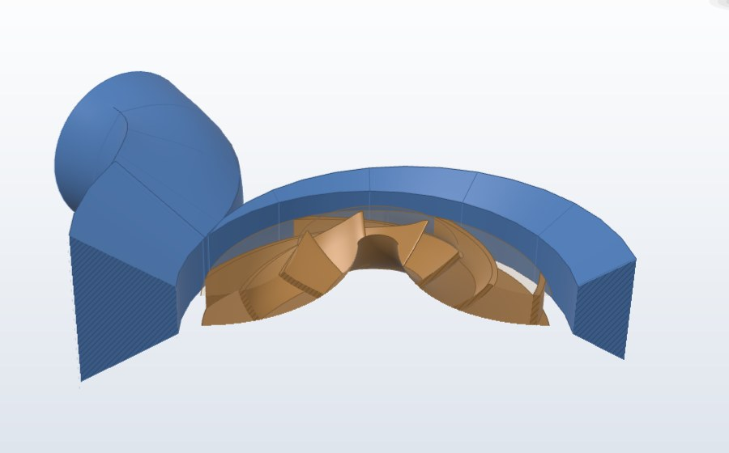 | 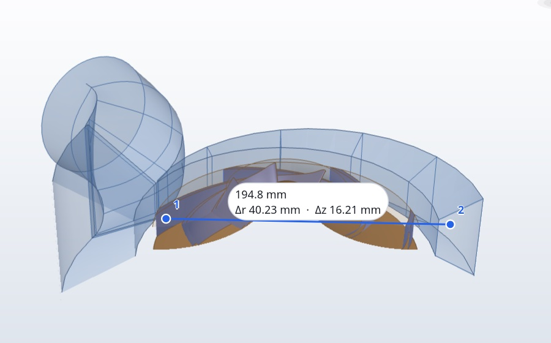 |

  - curvas: altura, rendimiento, potencia y NPSH₃ previstos frente al caudal (la altura
    a carga parcial según Gülich, cap. 4.3, y el NPSH₃ como banda de cinco métodos
    publicados), con la zona de recirculación estimada a trazos, el NPSH disponible y la pérdida en la
    voluta, que entra en la curva de altura; también los empujes radial y axial sobre
    el rodete, con o sin agujeros de equilibrado, el rendimiento por suma de pérdidas
    (fugas por los anillos, rozamiento de disco, pérdidas mecánicas y pérdidas
    hidráulicas del rodete y la voluta, y el rendimiento como producto
    η = η_h·η_v·η_RR·η_m), el caudal en que la garganta de la voluta pone el punto
    óptimo, la corrección
    para líquidos viscosos y el punto de trabajo en la instalación, con otra velocidad
    o el rodete recortado y el rango de funcionamiento continuo. Sus ajustes (el
    rango de la curva, las pérdidas y fuerzas, el líquido y la instalación) van en el
    panel de propiedades, con filas como las de un paso; dos botones arriba del panel
    pasan de los ajustes al paso, para cambiar el diseño mirando la curva;
  - informe con las mismas cifras que la línea de comandos.

  La vista meridional muestra también, si se pide, el flujo potencial y la velocidad
  meridional en cubo y carcasa. La del álabe añade la velocidad relativa en sus dos
  caras.

  Al abrir un paso, la vista cambia a la que mejor lo muestra, y en *Meridian* también
  el ámbito (se puede desactivar en los ajustes, *Behavior*).
- **Escena** (flota sobre la vista 3D): las piezas del modelo por componente, en el
  orden del flujo. Cada pieza tiene un ojo que la muestra u oculta (Alt+clic la aísla),
  su color (un clic abre el selector de color y opacidad), un botón que pasa por las
  tres opacidades (opaca, translúcida y cristal) y otro que la aísla; los álabes,
  además, uno o todos. El menú muestra u oculta todo, restablece la escena o la acopla a otra
  esquina; también se acopla arrastrando su cabecera a la esquina más cercana, y se
  pliega a una píldora. El modelo se centra en lo que dejan libre la Escena y el panel
  de propiedades. La esquina y el plegado se recuerdan.
- **Panel de propiedades** (derecha): al elegir un paso o el punto de diseño se abre
  con sus datos:
  - **arriba**, la ruta (componente › fase), el título, el estado, «paso n de m», la ⓘ
    con lo que hace el paso y un menú ⋯ para devolver el paso a automático o plegar
    todas sus secciones. El error del paso, o sus avisos, van al final de la misma
    fila del estado, recortados al sitio que queda (enteros al pasar el ratón; un clic
    los lista todos encima del formulario), así que al aparecer no mueven nada;
  - **en medio**, secciones que se pliegan, marcadas como resultados o comprobación
    cuando lo son. Cada valor que puede ser automático lleva un punto, como los del
    editor del meridiano: hueco y en gris si lo propone el programa, relleno si está
    fijado a mano. Las unidades van fuera del campo, en una columna propia a su
    derecha, también en los resultados. Escribir en un valor automático lo fija; un
    clic en el punto, o clic derecho en el valor, lo vuelve automático. La cabecera de cada sección dice
    cuántos valores tiene fijados a mano («● 2 a mano»); un clic ahí los vuelve todos
    automáticos de una vez, y un solo Cmd/Ctrl+Z los recupera. Cuando un paso ya
    aceptado queda por revisar, una barra naranja en el margen marca las filas que
    cambiaron desde que se aceptó (también las automáticas que movió un cambio aguas
    arriba), y su ayuda dice cuánto valían. Lo que mostraba cada fila al aceptarse se
    guarda con el proyecto: las marcas siguen ahí tras cerrar y volver a abrir, y no
    las cambian otras unidades ni otro idioma. Con el ratón sobre una fila que es una
    cota del dibujo (L, b₂, d_n, d₁ o d₂ en el meridiano; d₂, d₁, d_n o d_z en la
    vista frontal; b₃, o la altura de la garganta, en la de sección), esa cota se
    resalta en el dibujo,
    aunque las cotas estén ocultas; y con el ratón sobre el valor de una cota, su fila
    se sombrea en el panel;
  - **abajo**, la cifra clave del paso, *Back* y *Accept step and continue*
    (Cmd/Ctrl+Intro), que marca el paso como hecho y abre el siguiente, también en
    el componente siguiente. Con Mayús (o desde el menú ⋯), se completan todos los
    pasos que le faltan al componente con los valores sugeridos.

  El panel flota sobre la vista sin reducirla: se pliega a una franja estrecha (con su
  flecha o con Esc) y tiene el mismo ancho en todas las vistas y pasos; solo cambia
  arrastrando su borde izquierdo, y ese ancho se recuerda entre sesiones. Todas sus
  filas comparten columnas: etiquetas, campos, listas y unidades quedan alineados de
  arriba abajo. No bloquea las vistas, así que con él abierto se siguen arrastrando los puntos del contorno. La
  vista 3D centra la pieza en la parte que queda libre.
- **Barra de estado** (abajo): el último mensaje, las unidades y el contador de errores
  y avisos, que abre el panel de mensajes de todo el proyecto.
- **Idioma:** inglés o español, en los ajustes (el engranaje de la barra). La elección se guarda, y la
  primera vez se toma la del sistema. Los avisos del diseño también se traducen.
- **Edición:** todo se puede deshacer y rehacer (Cmd/Ctrl+Z, Cmd/Ctrl+Shift+Z). Un
  arrastre completo cuenta como un solo paso.
- **Exportación:** puntos, malla STL, dibujos en SVG, DXF o DWG, y sólidos CAD STEP, IGES
  o STL, que se construyen en segundo plano.

### La vista Meridian

La vista *Meridian* edita el corte meridional del rodete sobre el propio dibujo, sin
tablas. Tiene cuatro ámbitos, elegidos en su pestaña de la barra:
- *Stage*: la etapa completa, con el difusor y la voluta;
- *Impeller channel*: el canal del rodete;
- *Materials*: el disco del cubo y la tapa;
- *Side chambers*: las cámaras entre el rodete y la carcasa.

El ámbito sigue al paso abierto: el contorno meridional abre el canal, y el espesor de
pared de la voluta o el difusor abren la etapa. Un ámbito elegido a mano se respeta
mientras se edite el rodete.

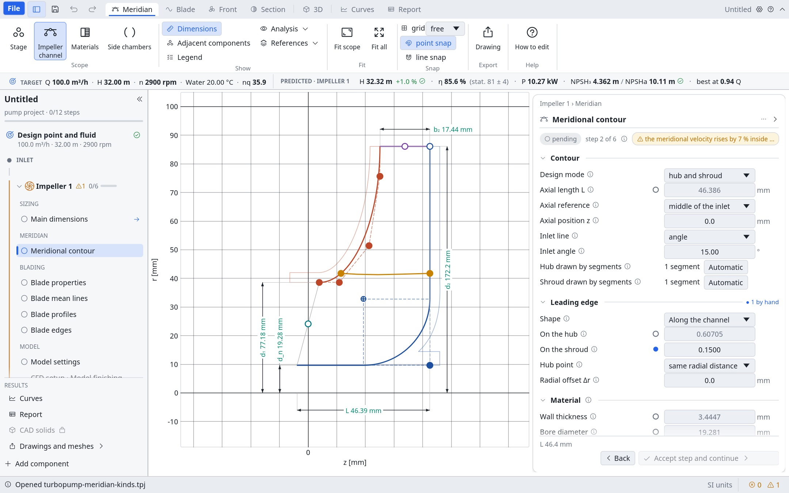

- **Tramos:** cada pared se compone de tramos que se parten, se unen o cambian de tipo
  con el botón derecho:
  - Bézier;
  - recta;
  - rectas unidas por un arco, cuyo centro se arrastra para cambiar el radio;
  - B-spline, con nudos que se insertan;
  - Bézier acoplada de grado 4, con curvatura nula en los extremos y los ángulos de
    entrada y salida fijables.

  Un tramo se puede desplazar en paralelo a sí mismo.
- **Imanes:** al arrastrar, los puntos se pegan a otros puntos y a las rectas cercanas.
  Con Ctrl se arrastran libres.
- **Cotas:** d_n, d₁, d₂, b₂ y L se dibujan sobre el contorno y se editan ahí. Un
  asa hueca es automática y una llena está fijada a mano; con doble clic vuelve a
  automática.
- **Borde de ataque:** su punto en el cubo es independiente o sigue al de la carcasa con
  un Δz o un Δr fijo.
- **Colocación:** el meridiano se sitúa en z desde el centro de la entrada o de la
  salida, y la línea de entrada puede ser normal al eje, axial o inclinada un ángulo.
- **Borde de salida:** d₂ se arrastra, y d₂i también en los rodetes radiales: con
  d₂i < d₂ el borde queda inclinado y el diseño usa el diámetro medio
  d₂m = √((d₂² + d₂i²)/2).
- **Modo de línea media:** en lugar de las dos paredes se dibuja la línea media del
  canal y una tabla de su área relativa, A = A₁ + A_rel(x)·(A₂ − A₁); cubo y carcasa
  quedan a ±b/2 con b = A/(2π·r).
- **Material:** el disco del cubo (con su agujero del eje y su núcleo) y la tapa (con su
  cuello) salen del espesor de pared, o se dibujan a mano. Los sólidos CAD usan ese
  mismo contorno.
- **Cámaras laterales:** la carcasa delantera, a la holgura axial de la tapa, con el
  anillo de cierre (holgura según Gülich, ec. 3.12), y la trasera hasta el sello del
  eje. Sus sellos pasan al empuje axial y al análisis de pérdidas cuando estos están en
  automático.
- **Tubería de entrada:** un tramo axial delante de la boca, para la entrada de un
  dominio de CFD: un anillo entre el cubo prolongado y la pared de la tubería, de
  longitud L = d₁ y tan ancho como la tapa en la entrada (valores nuestros, editables).
  Con las cámaras laterales diseñadas, termina a una holgura axial Δz (la misma s_ax)
  de la punta del cuello: la fuga del anillo de cierre sale a ese hueco y vuelve a la
  boca dentro del mismo dominio. Se dibuja en el ámbito Cámaras laterales y aparece en
  la Escena del 3D.

  | Meridiano | 3D, con el corte meridional |
  |---|---|
  | 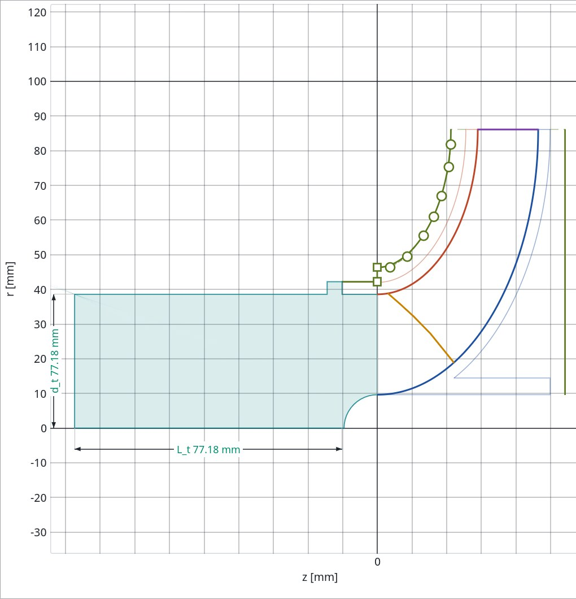 | 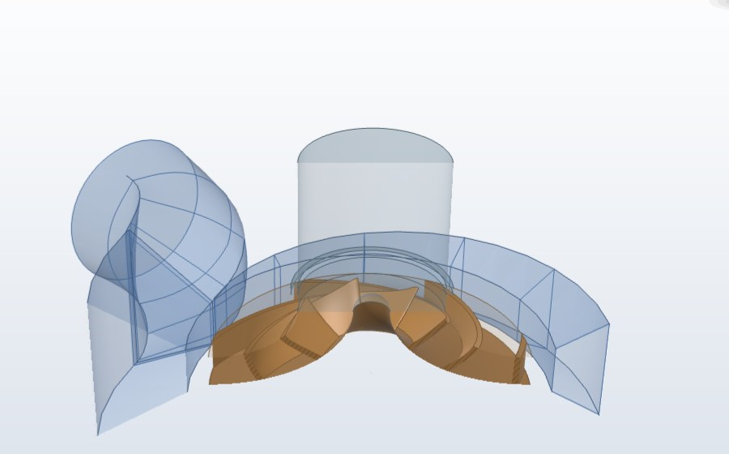 |

- **Cruces:** si dos paredes se cruzan, o una se cruza consigo misma, el punto se
  marca en rojo y sale un aviso.
- **Análisis:** la curvatura de las paredes, los círculos de área, las gráficas de área
  y de curvatura a lo largo del canal y curvas de referencia.
- **Flujo potencial:** líneas de corriente, isolíneas y mapa de color de c_m y
  vectores de velocidad, con el bloqueo de los álabes o sin él.
- **Comprobación:** el panel de propiedades compara el contorno con las
  recomendaciones de Gülich.

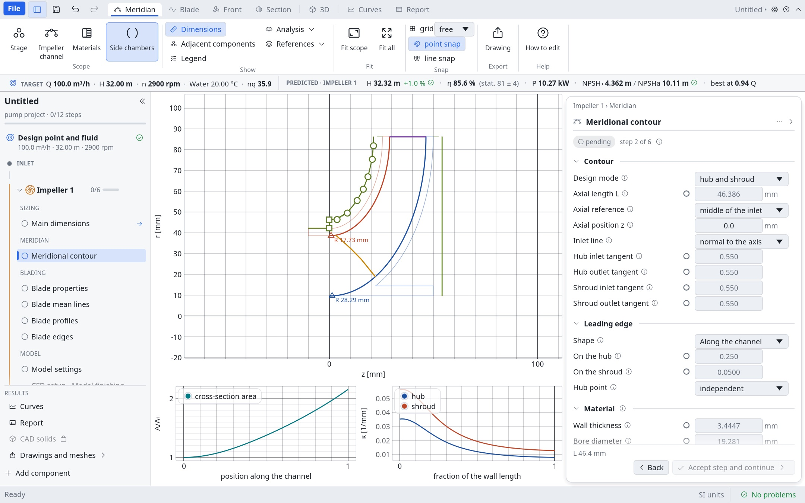

### Bordes del álabe

La vista *Blade* tiene una página *Edges*, que se abre con el paso *Blade edges*. Dibuja
los bordes de ataque y de salida en verdadera forma, a lo largo y a través de la línea
media, con las caras de presión y de succión y los puntos para arrastrar. Cuando la forma
cambia del cubo a la carcasa, salen las dos secciones. Hay cuatro formas:

- **cortado**, con el espesor completo hasta el borde meridional;
- **elíptico**, con su relación de longitud a semiespesor;
- **afilado y redondeo**: el espesor baja en recta hasta una nariz tangente al afilado,
  que puede inclinarse hacia una cara;
- **Bézier de grado 4**: los puntos 0 y 4 se deslizan por las caras, los 1 y 3 por sus
  tangentes y el 2 sube o baja; la nariz siempre llega justo al borde. Puede ser
  simétrica.

El panel da el $c_{p,min}$ del borde de ataque (Gülich, ec. 7.1a), que es una estimación
para las formas que no son elípticas.

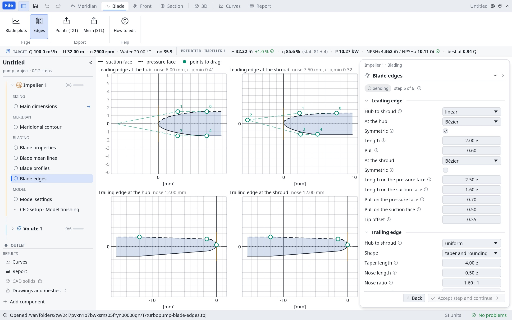

Las pruebas de la interfaz usan [kittest](https://github.com/rerun-io/kittest) y no
necesitan GPU. Las capturas con wgpu se generan a mano en `target/screenshots/`:

```bash
cargo test -p tp-gui --test screenshots -- --ignored
```

## Ejemplos de uso

Velocidad específica de una bomba de 100 m³/h, 32 m de altura y 2900 rpm:

```bash
cargo run -p tp-cli -- nq --flow "100 m3/h" --head "32 m" --speed "2900 rpm"
```

Crear un proyecto nuevo y ver su resumen:

```bash
cargo run -p tp-cli -- new bomba.tpj --machine pump --flow "100 m3/h" --head "32 m" --speed "2900 rpm"
```

```bash
cargo run -p tp-cli -- info bomba.tpj
```

Calcular las dimensiones principales del rodete. El resultado se guarda en el proyecto, y
cualquier valor se puede fijar con `--set` (los números sin unidad usan las del proyecto):

```bash
cargo run -p tp-cli -- design bomba.tpj
```

```bash
cargo run -p tp-cli -- design bomba.tpj --set d2=180 --set z=6
```

Construir la geometría del rodete (contorno meridional, flujo meridional, álabes,
espesores y bordes) y exportar puntos, malla STL y dibujos en SVG, DXF y DWG:

```bash
cargo run -p tp-cli -- geometry bomba.tpj --export salida
```

Con `--set` se fija también el borde de ataque por puntos (`le-points=Z,R;Z,R`), la
velocidad de entrada uniforme en todas las secciones (`inlet-velocity=uniform`) y el
envolvimiento (`wrap=linear`, común o libre).

Los bordes del álabe (`le`, `te`) pueden ser cortados, elípticos (`ellipse:4`), con un
afilado que acaba en un redondeo tangente y una asimetría opcional
(`taper:LONGITUD,NARIZ,RELACIÓN,ASIMETRÍA`), o una Bézier de grado 4 (`bezier:2,0.6`
simétrica, o `bezier:LP,LS,TP,TS,PUNTA`), con las longitudes en espesores del álabe.
`le-shroud-shape` y `te-shroud-shape` dan otra forma en la carcasa, y las secciones
intermedias se mezclan linealmente:

```bash
cargo run -p tp-cli -- geometry bomba.tpj --set le=bezier --set le-shroud-shape=bezier:2.5,1.6,0.7,0.5,0.35 --set te=taper
```

Los DWG salen en formato 2018; `--dwg-version 2013` elige otro (ver [DWG](#dwg)).

| Vista meridional | Vista frontal |
|---|---|
| 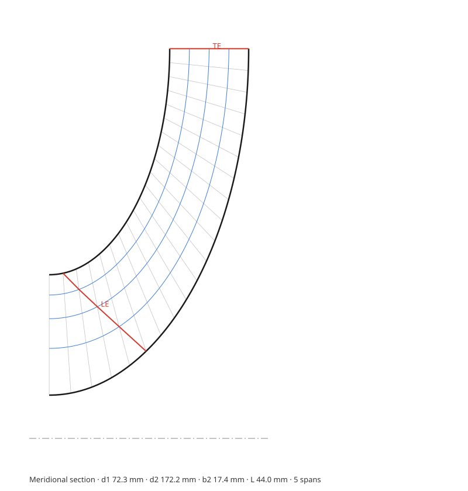 | 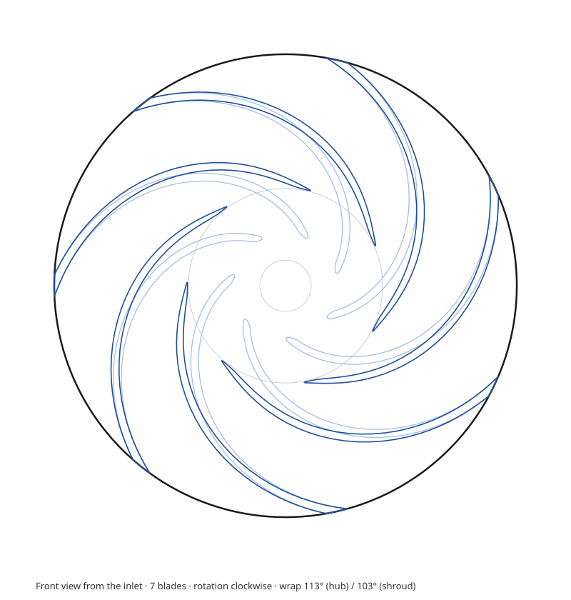 |

Sólidos CAD del rodete y del dominio fluido (Open CASCADE). El rodete lleva el cubo
hueco con su agujero del eje, la tapa con su cuello y redondeos donde los álabes tocan el
cubo y la tapa. El material sale del contorno del proyecto; `--wall`, `--bore` y `--boss`
lo sustituyen. `--balance-holes` taladra además los agujeros de equilibrado del empuje
axial:

```bash
cargo run -p tp-cli -- cad bomba.tpj --format step,iges,stl --balance-holes
```

| Rodete | Dominio fluido |
|---|---|
| 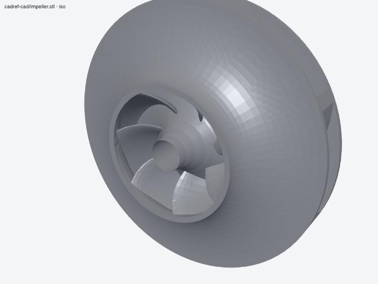 | 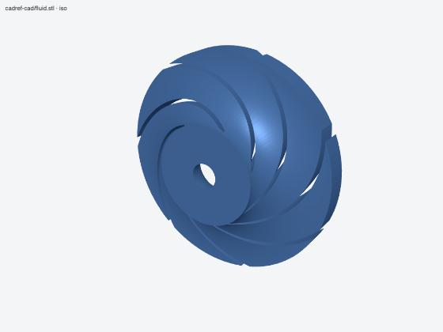 |

Una bomba completa se crea con sus componentes de la entrada a la salida: rodete,
estator con álabes (`stator`) o sin ellos (`vaneless-stator`) y voluta. Cada uno se
diseña con su orden, y `cad` construye los sólidos de todos; de la voluta salen el
dominio fluido (`volute.step`) y la carcasa con su espesor de pared y la brida de
salida (`volute-casing.step`). Con las cámaras laterales diseñadas salen también su
fluido (`side-chambers.step`) y, si a continuación del rodete viene una voluta, un único
fluido para CFD con rodete, cámaras y voluta (`fluid-joined.step`), unido por un anillo
en la salida del rodete. Con la tubería de entrada modelada sale su fluido
(`inlet-duct.step`), y el fluido unido empieza en ella: comparte la cara de entrada del
rodete y la salida del sello. Ese fluido necesita un borde de salida paralelo al eje
(d₂i = d₂). La altura de la cara de salida se puede fijar con
`turbopump volute --set height=…`:

```bash
cargo run -p tp-cli -- new etapa.tpj --machine pump --flow "100 m3/h" --head "32 m" --speed "2900 rpm" --components impeller,stator,volute
```

```bash
cargo run -p tp-cli -- design etapa.tpj
```

```bash
cargo run -p tp-cli -- geometry etapa.tpj
```

```bash
cargo run -p tp-cli -- diffuser etapa.tpj
```

```bash
cargo run -p tp-cli -- volute etapa.tpj --set shape=circle --export salida
```

```bash
cargo run -p tp-cli -- cad etapa.tpj --format step
```

La teoría y las cifras de la bomba de referencia están en
[docs/theory/voluta-y-difusores.md](docs/theory/voluta-y-difusores.md).

Curva característica prevista, de válvula cerrada a sobrecarga, también en CSV:

```bash
cargo run -p tp-cli -- performance bomba.tpj --csv curva.csv
```

Flujo potencial meridional y velocidades en las caras del álabe:

```bash
cargo run -p tp-cli -- analysis bomba.tpj
```

| Curva característica | Flujo potencial |
|---|---|
|  |  |

El método y sus límites están en [docs/theory/prestaciones.md](docs/theory/prestaciones.md).

Comparar un proyecto con los valores de referencia de un caso de validación. Cada
magnitud se juzga contra su tolerancia; el comando termina con código 2 si alguna queda
fuera, y `--list` muestra las magnitudes disponibles. Los casos están en
[tests/benchmarks/](tests/benchmarks/), y el resumen de lo comparado, con sus límites, en
[docs/validation/](docs/validation/). Para cargar ensayos propios hay una plantilla de
Excel en [tests/benchmarks/plantilla/](tests/benchmarks/plantilla/):

```bash
cargo run -p tp-cli -- validate tests/benchmarks/japikse-7.5/caso.tpj tests/benchmarks/japikse-7.5/targets.json
```

Propiedades de un líquido:

```bash
cargo run -p tp-cli -- fluid Water --temperature "60 °C"
```

Convertir unidades:

```bash
cargo run -p tp-cli -- convert 150 psi bar
```

## CoolProp

Turbopump usa [CoolProp](http://www.coolprop.org) para las propiedades de los fluidos y lo
carga al ejecutarse. Busca `libCoolProp.dylib` (macOS), `libCoolProp.so` (Linux) o
`CoolProp.dll` (Windows) en este orden:

1. la ruta de la variable `TURBOPUMP_COOLPROP`;
2. junto al ejecutable;
3. en el sistema.

Si no la encuentra, el agua sigue disponible con un modelo propio basado en IAPWS.
`TURBOPUMP_COOLPROP=none` desactiva CoolProp a propósito.

Durante el desarrollo se puede usar la copia que descarga `cargo` para las pruebas:

```bash
export TURBOPUMP_COOLPROP="$(cargo run -q -p tp-fluids --example coolprop_path)"
```

## DWG

Turbopump escribe los dibujos en DWG él mismo, con [acadrust](https://github.com/hakanaktt/acadrust)
(Rust puro, MPL-2.0). No hace falta instalar ningún otro programa. Las versiones son
2000, 2004, 2007, 2010, 2013 y 2018 (por defecto); en la línea de comandos se elige con
`--dwg-version`. El DXF lleva el mismo dibujo en formato AutoCAD 2000, que lee
cualquier programa CAD.

## Licencia

Puedes usar el proyecto bajo cualquiera de estas dos licencias, a tu elección:

- Apache License 2.0 ([LICENSE-APACHE](LICENSE-APACHE))
- MIT ([LICENSE-MIT](LICENSE-MIT))

Los binarios con CAD incluyen Open CASCADE enlazado de forma estática (LGPL-2.1 con la
excepción de Open CASCADE). El código fuente completo está disponible para volver a
enlazarlo.

La escritura de DWG usa [acadrust](https://github.com/hakanaktt/acadrust), bajo la Mozilla
Public License 2.0: su código fuente está en ese repositorio y en crates.io, y Turbopump
lo usa sin modificarlo.

La interfaz gráfica incluye la fuente Noto Sans, bajo la SIL Open Font License 1.1
([texto](crates/tp-gui/LICENSE-OFL-NotoSans.txt)), y los iconos
[Phosphor](https://phosphoricons.com), bajo licencia MIT.

Las contribuciones se aceptan bajo esas mismas dos licencias. Antes de contribuir, lee
[CONTRIBUTING.md](CONTRIBUTING.md), en especial las reglas de sala limpia.
