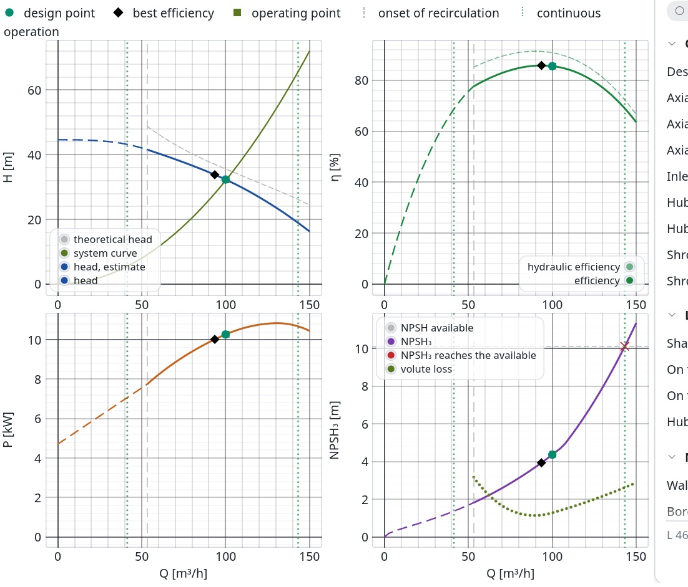
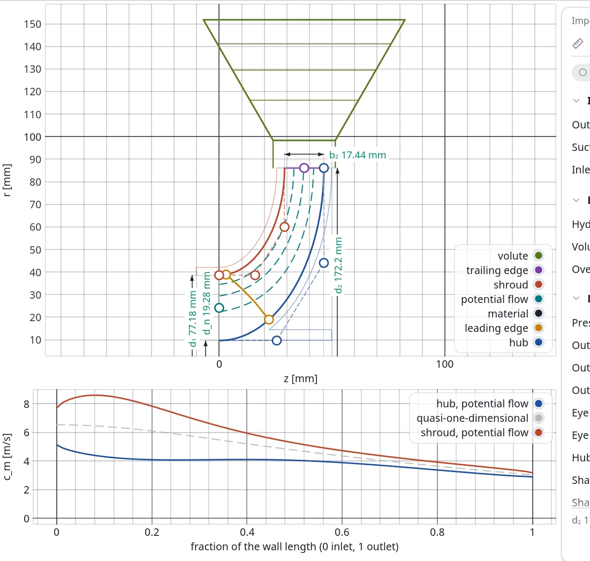

# Prestaciones y análisis del flujo

Implementación:

- [`crates/tp-design/src/performance.rs`](../../crates/tp-design/src/performance.rs) (curva característica);
- [`crates/tp-design/src/impeller/potential.rs`](../../crates/tp-design/src/impeller/potential.rs) (flujo potencial meridional);
- [`crates/tp-design/src/impeller/loading.rs`](../../crates/tp-design/src/impeller/loading.rs) (velocidades en las caras del álabe);
- [`crates/tp-math/src/sparse.rs`](../../crates/tp-math/src/sparse.rs) (sistemas dispersos);
- [`crates/tp-design/src/npsh.rs`](../../crates/tp-design/src/npsh.rs) (NPSH₃ frente al caudal);
- [`crates/tp-design/src/volute/loss.rs`](../../crates/tp-design/src/volute/loss.rs) (pérdidas de la voluta);
- [`crates/tp-design/src/radial_thrust.rs`](../../crates/tp-design/src/radial_thrust.rs) (empuje radial);
- [`crates/tp-design/src/axial_thrust.rs`](../../crates/tp-design/src/axial_thrust.rs) (empuje axial).

Este documento recoge siete análisis de un rodete ya diseñado:

- la **curva característica** prevista: altura, potencia y rendimiento frente al caudal;
- el **flujo potencial** en la sección meridional;
- las **velocidades relativas en las dos caras** de cada sección del álabe;
- el **NPSH₃ necesario** frente al caudal;
- las **pérdidas de la voluta** frente al caudal, que entran en la curva;
- el **empuje radial** sobre el rodete frente al caudal;
- el **empuje axial** sobre el rodete frente al caudal.

Las referencias principales son de Gülich, *Centrifugal Pumps*, 2.ª edición: capítulos 3
a 6 y 9. El modelo de la voluta es el de D. Japikse, W. D. Marscher y R. B. Furst,
*Centrifugal Pump Design and Performance*, Concepts ETI 1997, capítulo 4.3. Aquí solo se
citan los números de ecuación; la redacción, las derivaciones y las elecciones propias se
señalan como tales.

## 1. Curva característica

*Bomba de referencia (100 m³/h, 32 m, 2900 rpm, voluta). De arriba abajo: altura con la
altura teórica de Euler, rendimiento total e hidráulico, y potencia. Las líneas a trazos
son la parte estimada, por debajo del inicio de la recirculación. Los marcadores son el
punto de diseño (círculo) y el de máximo rendimiento (rombo).*

El libro advierte que ni las pérdidas hidráulicas ni la recirculación a carga parcial se
pueden calcular de antemano. Por eso la predicción es empírica y parte del punto de diseño
(cap. 4.3). Turbopump sigue ese esquema en cuatro partes.

### Altura teórica

Sin prerrotación a la entrada, el trabajo del rodete es $g H_{th} = u_2 c_{2u}$. La
componente $c_{2u}$ sale del triángulo de salida con el factor de deslizamiento
$\gamma$ y el bloqueo $\tau_2$ (ec. T3.2.7):

$$c_{2u} = u_2\,\gamma - \frac{c_{2m}\,\tau_2}{\tan\beta_{2B}}, \qquad
c_{2m} = \frac{Q_{La}}{\pi d_2 b_2}$$

$Q_{La}$ es el caudal por el rodete: el de la bomba más las fugas. Como primera
aproximación, el deslizamiento no depende del caudal mientras no haya recirculación
(cap. 4.1.1). Con eso, $H_{th}$ es una recta que baja al crecer el caudal (ec. 4.1).

### Rendimiento hidráulico y altura

La estadística de muchos ensayos da el rendimiento hidráulico relativo a su máximo
(ec. 4.14):

$$\frac{\eta_h}{\eta_{h,max}} = 1 - 0{,}6\,(q^* - 0{,}9)^2 - 0{,}25\,(q^* - 0{,}9)^3,
\qquad q^* = \frac{Q}{Q_{opt}}$$

El máximo cae en $q^* = 0{,}9$. $\eta_{h,max}$ se ajusta para que en el punto de diseño
$\eta_h$ sea el del diseño. La altura es $H = \eta_h\,H_{th}$ (ec. T3.3.7).

**Fugas:** las juntas dejan pasar un caudal que crece con la raíz de la presión que
soportan (ley de orificio), así que se escala con $\sqrt{H/H_{opt}}$. El valor en el punto
de diseño sale de $\eta_v$. Esta ley es una elección propia.

### Potencia y rendimiento

La potencia es la de Euler más las pérdidas secundarias:

$$P = \rho\,g\,H_{th}\,Q_{La} + P_{sec}$$

$P_{sec}$ reúne el rozamiento de discos y las pérdidas mecánicas, y apenas depende del
caudal (cap. 4.1.2, ec. T3.5.1). Se toma como lo que la potencia de diseño tiene de más
sobre la potencia de Euler. El rendimiento es $\eta = \rho g H Q / P$.

Con álabes curvados hacia atrás, la potencia de Euler es una parábola en el caudal. Su
máximo cae a la mitad del caudal de altura teórica nula (ecs. 4.4 y 4.5). En la bomba de
referencia ese máximo queda hacia 1,3 $Q_{opt}$.

### Zona de recirculación y válvula cerrada

**Inicio de la recirculación:** la recirculación a la entrada empieza típicamente entre
0,4 y 0,75 $Q_{opt}$, y sube con $n_q$ de 10 a 300 (cap. 5.2). Turbopump interpola en
$\ln n_q$ entre esos extremos. La interpolación es una elección propia; la ec. 5.7b afina
el valor, pero necesita la garganta de entrada y queda pendiente.

**Altura a válvula cerrada:** por debajo de ese caudal las pérdidas no se pueden
calcular. La altura se lleva hasta la de válvula cerrada, con el coeficiente de las
ecs. 3.27 y 3.28:

$$\psi_0 = 1{,}31\,e^{-0{,}3\,n_q/100} \ \text{(con difusor)}, \qquad
\psi_0 = 1{,}25\,e^{-0{,}3\,n_q/100} \ \text{(con voluta)}, \qquad
H_0 = \psi_0\,\frac{u_2^2}{2g}$$

El colector sale del componente que sigue al rodete. Un difusor sin álabes intercambia
menos cantidad de movimiento con el rodete que uno con álabes (cap. 4.1.4), así que usa el
valor de la voluta.

**Tramo entre válvula cerrada y recirculación:**

- la altura sigue una cúbica que sale plana de $H_0$ y se une a la curva calculada;
- la pendiente de unión se limita (criterio de monotonía de Fritsch y Carlson) para que la
  cúbica no añada un máximo propio;
- si aun así la curva sube en algún tramo, el programa avisa de que puede ser inestable;
- la potencia sigue la tangente de la curva calculada hasta $Q = 0$, o hasta un valor que
  da el usuario.

Todo este tramo se marca como estimación. El libro tampoco da una correlación de la
potencia a válvula cerrada más allá de una figura.

**Caudal máximo:** el cálculo llega a 1,5 $Q_{opt}$, dentro del rango de la estadística de
la ec. 4.14, o hasta que la altura se anula.

### Bomba de referencia

| Punto | Q | H | P | η |
|---|---|---|---|---|
| Válvula cerrada | 0 | 39,1 m | 3,0 kW (estimación) | 0 |
| Inicio de la recirculación | 53,2 m³/h (53 %) | 38,6 m | 7,77 kW | 0,717 |
| 75 % | 75,0 m³/h | 36,6 m | 9,45 kW | 0,791 |
| Máximo rendimiento | 95,9 m³/h (96 %) | 32,9 m | 10,53 kW | 0,815 |
| Diseño | 100,0 m³/h | 32,00 m | 10,68 kW | 0,814 |
| 125 % | 125,0 m³/h | 25,0 m | 11,20 kW | 0,760 |
| 150 % | 150,0 m³/h | 16,4 m | 10,99 kW | 0,609 |

Datos de partida: $\beta_{2B} = 22{,}0°$, $\gamma = 0{,}826$, $\tau_2 = 1{,}116$,
$\varphi_2 = 0{,}116$, $n_q = 35{,}9$ y $\psi_0 = 1{,}122$.

## 2. Flujo potencial meridional

*Arriba, las líneas de corriente del flujo potencial (a trazos) frente a las del flujo
cuasi unidimensional del paso meridional (grises). Abajo, $c_m$ a lo largo del cubo y de
la carcasa frente a la velocidad uniforme del cálculo cuasi unidimensional.*

**Ecuación:** el paso meridional del diseño supone $c_m$ uniforme en cada
cuasi-ortogonal. El flujo potencial quita esa hipótesis. En un cuerpo de revolución sin
rozamiento, y sin contar el efecto del giro, el flujo meridional tiene una función de
corriente de Stokes $\psi$ que cumple

$$\frac{\partial}{\partial z}\left(\frac{1}{r}\frac{\partial\psi}{\partial z}\right) +
\frac{\partial}{\partial r}\left(\frac{1}{r}\frac{\partial\psi}{\partial r}\right) = 0,
\qquad c_z = \frac{1}{r}\frac{\partial\psi}{\partial r},\quad
c_r = -\frac{1}{r}\frac{\partial\psi}{\partial z}$$

Entre dos superficies de corriente pasa un caudal igual a $2\pi$ veces su diferencia de
$\psi$.

**Discretización:**

- La malla es estructurada: líneas de la entrada a la salida a fracciones iguales de la
  longitud de cada pared, y nodos repartidos por igual de cubo a carcasa. Cada celda se
  parte en dos triángulos lineales.
- La forma débil $\int (1/r)\,\nabla\psi\cdot\nabla v\,dA = 0$ da una matriz simétrica y
  definida positiva, con $r$ tomado en el centro de cada triángulo. Se resuelve por
  gradiente conjugado con precondicionador diagonal.

**Condiciones de contorno:**

- $\psi = 0$ en el cubo y $\psi = 1$ en la carcasa (en fracción del caudal).
- En la entrada y la salida, la condición natural: el flujo cruza esas líneas en
  perpendicular.
- Para que esas fronteras no deformen el resultado se añaden dos prolongaciones rectas:
  un anillo axial delante del ojo, tan largo como alto es el ojo, y una corona radial de
  dos anchos de salida detrás de $d_2$. Los resultados se dan solo en el canal del rodete.

**Velocidades:** $c_m = (Q/2\pi)\,|\nabla\psi|/r$ en cada triángulo, promediado por área
en los nodos. Las líneas de corriente son las curvas de $\psi$ constante.

**Validación:** contra dos soluciones exactas, con un error por debajo del 1 %:

- en un anillo axial, $c_z = Q/(\pi(r_s^2 - r_h^2))$ uniforme y
  $\psi = (r^2 - r_h^2)/(r_s^2 - r_h^2)$;
- entre dos discos paralelos, $c_r = Q/(2\pi r b)$.

**Bomba de referencia:** malla de 81 × 21 nodos en el canal; 186 iteraciones.

| Fracción de pared | $c_m$ cubo | $c_m$ carcasa | Cuasi 1D |
|---|---|---|---|
| 0 (entrada) | 5,13 m/s | 7,70 m/s | 6,53 m/s |
| 0,125 | 4,22 m/s | 8,45 m/s | 6,35 m/s |
| 0,25 | 4,07 m/s | 7,32 m/s | 5,89 m/s |
| 0,5 | 4,05 m/s | 5,26 m/s | 4,76 m/s |
| 0,75 | 3,51 m/s | 4,10 m/s | 3,81 m/s |
| 1 (salida) | 2,89 m/s | 3,17 m/s | 3,04 m/s |

En el codo de axial a radial la carcasa es la pared interior y el flujo va más rápido por
ella, hasta un 40 % por encima del valor medio. Hacia la salida el perfil se aplana y la
media coincide con la continuidad.

## 3. Velocidades en las caras del álabe

**Velocidad media:** en cada sección se supone que el flujo sigue a los álabes, sin
deslizamiento. $c_m$ se toma del flujo meridional del diseño, interpolada entre las dos
cuasi-ortogonales que rodean cada punto. La velocidad relativa media es
$w = c_m\,\tau / \sin\beta_B$, con el bloqueo local $\tau$ del espesor.

**Diferencia entre caras (derivación propia):** un tramo de álabe de longitud $ds$, sobre
la superficie de corriente, que eleva $r c_u$ en $d(r c_u)$ lleva la circulación
$2\pi\,d(r c_u)/z$. Esa circulación es la integral de la velocidad alrededor del tramo,
$(w_{SS} - w_{PS})\,ds$. Por tanto:

$$\Delta w = w_{SS} - w_{PS} = \frac{2\pi}{z}\,\frac{d(r c_u)}{ds}, \qquad
w_{SS,PS} = w \pm \frac{\Delta w}{2}$$

**Giro:** $c_u = u - c_m / \tan\beta_B$ se toma de la línea media, sin el bloqueo. El
espesor, que crece desde cero en un borde redondeado, acelera el flujo pero no lo
desvía; meterlo en $c_u$ daría una carga falsa en el borde de ataque.

**Comprobación:** al integrar $\Delta w$ a lo largo del álabe se recupera $2\pi/z$ veces el
cambio de $r c_u$ entre bordes.

**Aviso:** el programa avisa si la cara de presión llega a velocidad negativa, porque el
flujo se despegaría allí.

**Bomba de referencia:** $u_2 = 26{,}15$ m/s.

| Span | $w_{SS,max}/u_2$ | $w_{PS,min}/u_2$ | $w$ medio en el borde de ataque | $w$ medio en el de salida |
|---|---|---|---|---|
| 0 (cubo) | 0,585 | 0,043 | 0,283 | 0,345 |
| 0,5 | 0,626 | 0,065 | 0,377 | 0,345 |
| 1 (carcasa) | 0,661 | 0,034 | 0,454 | 0,345 |

## 4. NPSH₃ frente al caudal

El procedimiento es el del capítulo 6.3.3 de Gülich. La entrada se supone sin
prerrotación.

**Ecuación base** (ec. 6.10):

$$NPSH_3 = \lambda_c\,\frac{c_{1m}^2}{2g} + \lambda_w\,\frac{w_1^2}{2g}$$

- $c_{1m}$ es la velocidad meridional en la boca y $w_1$ la relativa en la línea de
  corriente exterior del borde de ataque.
- $\lambda_c = 1{,}1$ con entrada axial (de 1,2 a 1,35 con carcasa de entrada radial).
- En el punto de diseño, $\lambda_{w,3} = 0{,}3\,(\tan\beta_{1a})^{0,57}$, con
  $\beta_{1a}$ el ángulo del flujo en la línea exterior (Fig. 6.20, dispersión de
  ±25 %). Los datos de la figura van de 10° a 25°; fuera de ese rango el informe dice
  que el valor está extrapolado.

**Tres caudales característicos:**

| Caudal | Qué pasa | Ec. |
|---|---|---|
| $Q_{SF}$ | entrada sin choque en la línea exterior: por encima, la incidencia es negativa y la cavitación pasa a la cara de presión | 6.17 |
| $Q_W$ | la velocidad relativa $w_1$ iguala a la de la garganta de entrada $w_{1q}$: por encima, el flujo acelera hacia la garganta | 6.18 |
| $Q_c$ | la velocidad media en la garganta del colector iguala a $c_{2u}$ | 6.19 |

La garganta de entrada de los álabes se estima con las dimensiones principales: el paso
por el seno del ángulo del álabe menos el espesor, en el diámetro medio, por el ancho de
la boca. Es una estimación propia; la geometría real la afinará.

**La curva:**

- El codo es $Q_{sa}$, el menor entre $Q_c$ y $Q_{PS} = (Q_{SF} + Q_W)/2$ (ec. 6.20).
- Por debajo de $Q_{sa}$ se usa la ec. 6.10 con
  $\lambda_w = \lambda_{w,opt}\,(\tan\beta_1/\tan\beta_{1,opt})^{0,57}$ (ec. 6.21).
- Por encima sube como $NPSH_{sa}\,(Q/Q_{sa})^x$ (ec. 6.22). El libro da $x$ de 2 a 3;
  usamos 2,5 por defecto.
- Los valores por debajo del inicio de la recirculación se marcan como estimación, igual
  que la altura.

El NPSH disponible sale de la presión total de entrada y la presión de vapor. Si la
curva lo alcanza dentro del rango calculado, el programa avisa del caudal.

El NPSH₃ del paso de dimensiones principales sigue siendo el de la velocidad específica
de aspiración $n_{ss}$: es el objetivo de diseño. El de la curva sale de la geometría de
la entrada.

**Comprobación con el libro de Japikse:** en su ejemplo del capítulo 7.5, la ec. 6.10
con $\lambda_c = 1$, $\lambda_w = 0{,}20$ y las velocidades en la punta de la entrada
($c_{1m} = 13{,}343$ ft/s, $w_1 = 55{,}88$ ft/s) da exactamente el NPSH que publica,
12,47 ft. Es una prueba automática.

**Bomba de referencia** (con su voluta):

| Magnitud | Valor |
|---|---|
| $\beta_{1a}$, $\lambda_{w,3}$ | 28,8° (por encima de los datos), 0,215 |
| $NPSH_3$ en el diseño | 4,36 m |
| $Q_{SF}$ / $Q_W$ / $Q_c$ | 100 % / 113 % / 125 % |
| $Q_{sa}$ | 107 % |
| NPSH disponible | 10,1 m, que la curva alcanza al 143 % |

El valor de diseño es mayor que el de $n_{ss} = 200$ (3,2 m) porque el ojo de la
referencia es pequeño: el ángulo $\beta_{1a}$ queda por encima de los de la figura 6.20.

## 5. Pérdidas de la voluta frente al caudal

**Modelo de la espiral** (Japikse, ecs. 4.4 a 4.8). En la entrada de la voluta
(estación 5) se definen el parámetro de giro $\lambda = c_{\theta 5}/c_{m5}$ y la
relación de áreas $AR = A_7/A_5$, la garganta frente a $2\pi r_5 b_5$:

- la energía cinética meridional que entra en la espiral se pierde:
  $K_m = 1/(1 + \lambda^2)$ (ec. 4.7);
- si el giro tiene que frenar hasta la velocidad de la garganta $c_7$, se pierde como en
  un ensanchamiento brusco: $K_\theta = (\lambda - 1/AR)^2/(1 + \lambda^2)$ (ec. 4.8);
  si acelera, no se pierde nada más;
- la recuperación estática es $C_p = 1 - 1/(AR^2(1 + \lambda^2)) - K$ (ec. 4.6).

**Lectura propia del vórtice libre.** El libro deja que el giro se frene como vórtice
libre de $r_5$ a un radio $r_6$ antes del ensanchamiento. Lo leemos como el giro en el
centro de la garganta, $\lambda_6 = \lambda\,r_5/r_6$, que es el que se compara con
$c_7$. (El libro escribe en su lugar un factor $(r_5/r_6)^2$ sobre la pérdida.) Con
$r_6 = r_5$ las dos formas son la ec. 4.8. Con nuestra lectura, una espiral dimensionada
por momento angular tiene su menor pérdida en su caudal de diseño, como dice Gülich en el
capítulo 4.2.

**Entrada y garganta.** La entrada es el círculo de la lengüeta con el ancho $b_3$; el
giro llega a ella como vórtice libre desde $r_2$, también a través de un difusor sin
álabes. La garganta y su radio de centro salen del diseño de la voluta.

**Tobera.** Pierde $(c_{p,id} - c_p)\,c_7^2/2g$, con $c_{p,id} = 1 - 1/A_R^2$
(Gülich ec. 1.40) y una recuperación real limitada por la mejor que alcanza un difusor
de esa longitud, $c_{p,opt} = 0{,}36\,(L/R_1)^{0,26}$ (Gülich ec. 7.31).

**Cómo entra en la curva (reparto propio).** La estadística de la ec. 4.14 describe
bombas con volutas bien dimensionadas. Por eso:

1. En el punto de diseño, las pérdidas hidráulicas $(1 - \eta_h)H_{th}$ se reparten entre
   una **voluta ajustada equivalente** (la misma con la garganta que da
   $\lambda_6 \cdot AR = 1$) y el resto de la etapa.
2. El resto conserva la forma estadística de la ec. 4.14.
3. La voluta real añade sus propias pérdidas a cada caudal:
   $H = H_{th} - h_{voluta}(Q) - h_{resto}(Q)$.

Una voluta ajustada deja la curva casi igual. Una garganta pequeña pierde altura en el
diseño, adelanta el máximo rendimiento y pierde mucha altura en sobrecarga. Una garganta
grande retrasa el máximo y pierde menos en la tobera; Gülich recomienda algo de exceso
de garganta cuando la sigue un difusor con pérdidas (cap. 4.2).

**Comprobación con el libro de Japikse** (ejemplo del capítulo 7.5, tras un difusor sin
álabes, $\lambda \cdot AR = 1$). Son pruebas automáticas:

| Magnitud | Modelo | Libro |
|---|---|---|
| $AR$ | 0,2393 | 0,24 |
| $K$ de la espiral | 0,0542 | 0,054 |
| $C_p$ de la espiral | 0,000 | 0,000 |
| $K$ de espiral y tobera | 0,234 | 0,234 |
| $C_p$ de espiral y tobera | 0,356 | 0,356 |

Además, la etapa diseñada por Turbopump para el mismo punto (5000 gpm, 84,05 ft,
1000 rpm, con difusor sin álabes y voluta) sale ajustada como la del libro:
$\lambda = 4{,}23$ frente a 4,18 y $K = 0{,}053$ frente a 0,054.

**Bomba de referencia:**

| Magnitud | Valor |
|---|---|
| $\lambda$, $AR$, $\lambda_6 \cdot AR$ | 7,11, 0,187, 0,99 |
| Pérdida en el diseño | 1,28 m, el 39 % de las pérdidas hidráulicas |
| Espiral / tobera | 0,14 m ($K$ = 0,019) / 1,14 m |
| Menor pérdida | al 99 % del caudal de diseño |
| Altura en el diseño | 31,97 m (la voluta está ajustada al 99 %) |
| Máximo rendimiento | 93 % del caudal, η = 0,817 |

## 6. Empuje radial

Fuera del punto de diseño, la presión alrededor del rodete deja de ser uniforme en la
voluta y aparece una fuerza radial que cargan el eje y los cojinetes. Turbopump sigue la
tabla 9.4 de Gülich (cap. 9.3):

$$F_R = k_R\,\rho\,g\,H\,d_2\,b_{2,tot} \qquad \text{(ec. 9.6)}$$

$b_{2,tot}$ es el ancho de salida con las dos tapas del rodete. Su espesor por defecto es
el del modelo CAD, $\max(3\ \text{mm};\ 0{,}02\,d_2)$. $q^*$ se refiere al punto de
diseño del colector.

**Voluta simple:**

- $k_{R0}$ a válvula cerrada, del ajuste de la figura 9.27 frente a
  $n_{q,tot} = n_q\sqrt{f_q}$. La curva 1 es para holguras normales (ec. 3.12) y la
  curva 2 para holguras dobles (`--set clearances=wide`).
- $k_{R,opt}$ en $q^* = 1$, del ajuste de la figura 9.28.
- Entre los dos, $k_R = (k_{R0} - k_{R,opt})(1 - q^{*2}) + k_{R,opt}$.
- Por encima de $q^* = 1$, $k_R = k_{R,opt}\,q^{*2}$, la alternativa que da la tabla al
  factor 0,09.

**Voluta doble:**

- $k_R = F_{Dsp}\,k_{R0}$ con $F_{Dsp} = 1{,}75 - 0{,}0083\,\varepsilon_{sp}$
  (fig. 9.29), casi constante hasta $q^* \approx 1{,}1$.
- Con nervios de menos de 180°, la fórmula de interpolación de la tabla acerca los
  valores en $q^* = 0{,}5$ y 1 a los de la voluta simple.
- Por encima de 1,1 el libro dice que la fuerza puede subir mucho; seguimos con $q^{*2}$
  (elección propia).

**Difusor con álabes:** la tabla da rangos ($k_{R0}$ = 0,02 a 0,09 y $k_{R,opt}$ = 0,01
a 0,06). Usamos el centro de cada uno con la ley de la voluta simple (elección propia).

**Para el diseño mecánico** se suma la parte variable $k_{R,dyn}$ (centro de los rangos
de la tabla) y se toma $k_{R,tot} \ge 0{,}15$ (notas 12 y 13 de la tabla).

Un difusor sin álabes toma el empuje de la voluta que lo sigue. Sin voluta detrás no hay
datos.

**Bomba de referencia** (voluta simple, $n_q$ = 35,9):

| Punto | $k_R$ | $F_R$ |
|---|---|---|
| Diseño | 0,023 | 30 N |
| Válvula cerrada | 0,304 | 487 N |
| Para el diseño mecánico | — | 640 N |

## 7. Empuje axial

Las presiones sobre los dos discos del rodete no se compensan: el trasero tiene más área
mojada, desde el sello del eje $d_D$ hasta $d_2$, que el delantero, desde el anillo de
desgaste $d_{sp}$. La fuerza resultante empuja el rodete hacia la aspiración y la carga
el cojinete axial. Turbopump sigue la tabla 9.2 de Gülich (cap. 9.2), con el signo del
libro: **positivo hacia la aspiración**.

**Subida de presión en el rodete** (ec. T9.2.2, con $\eta_{h,La}/\eta_h = 1$ como
aconseja el libro y $H/\eta_h = H_{th}$):

$$\Delta p_{La} = \rho\,g\,H\left(1 - \frac{g\,H_{th}}{2\,u_2^2}\right)$$

**Giro del líquido en las cámaras laterales** (tabla 9.1):

- Sin fuga, $k_o = 0{,}5$: es la ec. T9.1.3 para cámaras abiertas al colector
  ($r_w = r_2$, $t_{ax} = 0$) con el mismo rozamiento en la carcasa y en el rodete. Se
  puede cambiar.
- La fuga hacia dentro por el anillo delantero acelera el giro:
  $k = k_o\,e^{300\,\varphi_{sp}(r_2/r_{sp} - 1)}$ (ec. T9.1.4 con $b = 1$).
- $\varphi_{sp} = 5{,}5\cdot10^{-4}\,\psi_{opt}^{1,5}(n_q/20)^{0,4}$ para las holguras de
  la ec. 3.12 (ec. T9.1.2a). Con `clearances=wide` se dobla (elección propia, como en el
  empuje radial).
- Fuera del diseño la fuga se escala con $\sqrt{H/H_{opt}}$, porque sigue a la
  diferencia de presión en el anillo (elección propia).

**Fuerzas** (tabla 9.2):

- Sobre cada disco, ec. T9.2.3, con $x = d_{sp}/d_2$ delante y $x = d_D/d_2$ detrás:
  $$F = \pi r_2^2\left\{(1 - x^2)\,\Delta p_{La} - \frac{\rho}{4}\,u_2^2\,\bar k^2\,(1 - x^2)^2\right\}$$
  Es la integral de la presión de la ec. T9.1.7 entre $x$ y $r_2$; una prueba lo
  comprueba.
- $F_{Hy} = F_{RS} - F_{FS}$ (ecs. T9.2.6 y T9.2.8, con un $k$ distinto en cada disco).
- Cantidad de movimiento $F_I = \rho\,Q_{La}\,c_{1m}$, con $\varepsilon_2 = 90°$ en
  rodetes radiales (ec. T9.2.9). $Q_{La}$ incluye la fuga del anillo delantero.
- Fuerza sobre el eje $F_w = \frac{\pi}{4}\,d_D^2\,(p_{amb} - p_1)$ (ec. T9.2.10), con
  $p_1$ la presión estática en el ojo y la atmósfera estándar fuera del sello.
- Total $F_{ax} = F_{Hy} - F_I + F_w$ (ec. T9.2.11), sin la fuerza del acoplamiento.

**Con agujeros de equilibrado** y un anillo trasero de diámetro $d_{s2}$ (por defecto
$d_{sp}$):

- Queda una fracción de la fuerza sin agujeros, de 0,1 a 0,2 según la ec. T9.2.14;
  tomamos 0,15.
- Se suma la fuerza de la ec. T9.2.13 cuando $d_{s2} \ne d_{sp}$. Un anillo trasero
  mayor empuja hacia la impulsión.

**Rodete de doble aspiración:** se equilibra solo, salvo un resto de signo desconocido,
$F_{ax} = f_{ax}\,\frac{\rho}{2}\,u_2^2\,(d_2^2 - d_{sp}^2)$ (ec. T9.2.15). Tomamos
$f_{ax}$ = 0,015, el centro del rango estacionario de 0,01 a 0,02. La parte variable
puede llegar a 0,02–0,06.

**Diámetros por defecto (elección propia):**

- $d_{sp}$: el ojo $d_1$ más el espesor del disco por los dos lados, el mismo
  $\max(3\ \text{mm};\ 0{,}02\,d_2)$ del modelo CAD.
- $d_D$: el diámetro del cubo.

**Comprobación:** el informe da también la estimación rápida de la ec. T9.2.12,
$(0{,}7\ \text{a}\ 0{,}9)\,\rho\,g\,H\,\frac{\pi}{4}(d_{sp}^2 - d_D^2)$.

**Bomba de referencia** (sin agujeros, $d_{sp}$ = 84,1 mm, $d_D$ = 19,3 mm):

| Parte | Diseño |
|---|---|
| $\Delta p_{La}$ | 234 kPa (0,75 $\rho g H$) |
| $\bar k$ delante / detrás | 0,61 / 0,50 |
| Discos $F_{Hy}$ | 1107 N |
| Cantidad de movimiento $F_I$ | 180 N |
| Eje $F_w$ | 6 N |
| **Total** | **933 N hacia la aspiración** |
| A válvula cerrada | 1105 N |
| Estimación rápida (ec. T9.2.12) | 1152 a 1481 N |

Con agujeros de equilibrado el total baja a unos −8 N.

**Avisos:** si sin agujeros la fuerza apunta hacia la impulsión, el programa avisa. Pasa
con presiones de aspiración altas, como en las bombas de circulación de calderas (cap.
9.2.2).

## Dónde se usa

- **Interfaz:**
  - vista *Curves*, con el inicio de la recirculación, $\psi_0$ y el caudal máximo
    ajustables, y una cuarta gráfica con el NPSH₃, el NPSH disponible y la pérdida en
    la voluta;
  - opción *potential flow* de la vista meridional;
  - cuarta gráfica de la vista *Blade*;
  - secciones nuevas del informe.
- **Línea de comandos:** `turbopump performance`, que escribe la curva también en CSV
  (con el NPSH₃ y la pérdida en la voluta), y `turbopump analysis`, con el flujo
  potencial y las caras del álabe, también en CSV. Los coeficientes del NPSH₃ se fijan
  con `--set npsh_inlet=`, `npsh_blade=` y `npsh_exponent=`, y las holguras de los
  empujes con `--set clearances=wide`. Para el empuje axial están `seal=`,
  `shaft_seal=`, `balance=on`, `rear_seal=` y `k0=`. El CSV añade la columna
  `axial_force_n`.
- **Interfaz:** la vista *Curves* da el empuje axial en el diseño y a válvula cerrada,
  con una casilla para los agujeros de equilibrado; el informe da sus partes.

## Limitaciones

- **Curva:**
  - el deslizamiento es constante con el caudal; la dependencia que muestra la estadística
    del libro solo está en una figura;
  - la potencia a válvula cerrada es una extrapolación.
- **NPSH₃:** la garganta de entrada de los álabes es una estimación. Con recirculación a
  la entrada el NPSH₃ real deja de bajar o sube, y eso no está modelado.
- **Voluta:** solo se modela una voluta detrás del rodete, directamente o tras un difusor
  sin álabes. La pérdida de la tobera es una estimación por la longitud. Tras un difusor
  con álabes, su garganta fija el codo del NPSH₃, pero sus pérdidas siguen en la
  estadística.
- **Flujo potencial:** no tiene en cuenta el giro ni el rozamiento, y no se usa todavía
  para construir los álabes; el diseño sigue con el flujo cuasi unidimensional.
- **Velocidades en las caras:** sin deslizamiento, la carga no se anula en el borde de
  salida como en el flujo real.
- **Empuje axial:**
  - el giro de entrada a las cámaras laterales y la recirculación a carga parcial, que
    según Gülich son la mayor incertidumbre, no se modelan;
  - $k$ es un promedio (opción A del libro), no la integración paso a paso de la ec.
    T9.1.9;
  - en bombas multietapa la cifra es la de un rodete; faltan los tambores y discos de
    equilibrado (cap. 9.2.3);
  - faltan los rodetes semiaxiales y axiales (ecs. T9.2.16 a T9.2.18).
- **Pendiente:** el análisis álabe a álabe en dos dimensiones.
