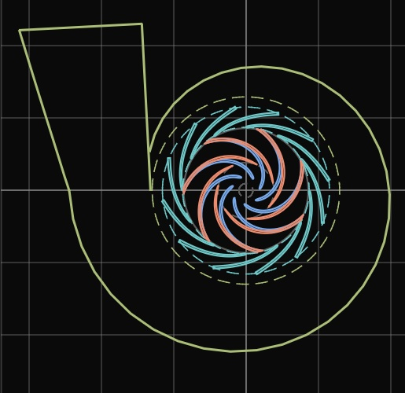

# Voluta y difusores

Implementación:

- [`crates/tp-design/src/volute/`](../../crates/tp-design/src/volute/)
- [`crates/tp-design/src/diffuser/`](../../crates/tp-design/src/diffuser/)
- [`crates/tp-design/src/outlet.rs`](../../crates/tp-design/src/outlet.rs)

El rodete entrega el fluido con mucha velocidad tangencial: en la bomba de referencia,
$c_{2u} = 13{,}2$ m/s frente a $c_{2m} = 2{,}8$ m/s. Los componentes que siguen convierten
parte de esa energía cinética en presión y llevan el caudal hasta la tubería. Turbopump
tiene tres:

- **voluta de salida:** canal en espiral, lengüeta y difusor de descarga;
- **difusor sin álabes:** anillo de paredes paralelas;
- **difusor con álabes:** corona de álabes fijos entre $d_3$ y $d_4$.

Las referencias son de Gülich, *Centrifugal Pumps*, 2.ª edición: capítulos 7.8 (voluta),
7.9 y 7.12 (difusores), tabla 7.7 (procedimiento de cálculo) y tabla 10.2 (holguras y
número de álabes contra las pulsaciones de presión). Aquí solo se citan los números de
ecuación; la redacción y los valores por defecto son propios.

*Vista frontal desde la entrada: rodete de 7 álabes, difusor de 12 álabes y voluta
dimensionada desde $d_4$. La bomba de referencia es de 100 m³/h, 32 m y 2900 rpm.*

## Acoplamiento entre componentes

Cada componente toma su entrada del que tiene delante. Esa entrada es la salida del
rodete o del estator anterior:

| Dato | Tras un rodete | Tras un estator |
|---|---|---|
| Caudal | $Q$ del rodete | el mismo |
| Diámetro | $d_2$ | $d_4$ |
| Anchura | $b_2$ | $b_4$ |
| Velocidad tangencial | $c_{2u}$ | $c_{4u}$ |
| Velocidad meridional | $c_{2m}$ | $c_{4m}$ |

También pasan la velocidad específica $n_q$, la altura de la etapa, la densidad, el plano
medio del canal, el número de álabes del rodete y el sentido de giro.

Si cambia un dato aguas arriba, los pasos de los componentes de detrás quedan
desactualizados (⟲) hasta que se vuelven a aceptar.

**Ángulos:** el ángulo de la espiral $\varepsilon$ se mide desde la lengüeta en el sentido
de giro. La lengüeta está sobre el eje $+x$, y una sección de ángulo $\varepsilon$ queda en
$\theta = s\,\varepsilon$. El signo $s$ es el mismo que en el rodete
([geometria-rodete.md](geometria-rodete.md)).

## Voluta

Se diseña en seis pasos: datos de partida, sección transversal, desarrollo de la
espiral, difusor de descarga, lengüeta y espesor de pared.

### 1. Datos de partida

- **Caudal de diseño:** $Q_{Le} = Q \cdot (Q_{Le}/Q)$. El factor vale 1 por defecto y
  permite reservar caudal para las fugas que pasan por la voluta (ec. T7.7.1).
- **Diámetro de la lengüeta:** el mínimo de la tabla 10.2 para que las pulsaciones de
  presión sean bajas:

  $$\frac{d_z}{d_2} \ge 1{,}03 + 0{,}1\,\frac{n_q}{40} + 0{,}07\,\frac{\rho H}{\rho_{Ref} H_{Ref}}$$

  Aquí $\rho_{Ref} = 1000$ kg/m³ y $H_{Ref} = 1000$ m. El valor automático es ese
  mínimo, y un valor manual por debajo genera un aviso.
- **Espesor de la lengüeta:** $e_3 \approx 0{,}02\,d_2$ (cap. 7.8.1). El flujo se
  estanca en la nariz, a $r'_z = r_z + e_3/2$, y desde ese radio se integran las
  secciones.
- **Anchura de entrada:** $b_3/b_2$ baja linealmente de 2,0 (con $n_q \le 15$) a 1,2 (con
  $n_q \ge 55$). Queda dentro de los márgenes que da el libro para $n_q$ bajas y altas.
  La interpolación es una elección propia.

### 2. Sección transversal

Implementación: [`crates/tp-design/src/volute/section.rs`](../../crates/tp-design/src/volute/section.rs).

Cada sección se dibuja en su propio plano radial con dos coordenadas: $s = z - z_m$ a lo
ancho (la anchura $B$, positiva hacia $+z$) y $h = r - r'_z$ hacia fuera desde el
círculo de estancamiento (la altura $H$). La entrada de anchura $b_3$ une la sección con
el anillo sin álabes en $h = 0$, entre los puntos de entrada $(\mp b_3/2,\ 0)$.

**Definiciones.** La forma no tiene por qué ser la misma en toda la espiral. Una tabla de
definiciones da, para varios ángulos $0 < \varphi \le 360°$, la forma de la sección, que
puede activarse o no. En $\varphi = 0$ la sección siempre es plana, así que allí no se
define nada. Entre dos definiciones activas la forma cambia con suavidad: los contornos
de ambas, a la misma altura, se mezclan punto a punto con el peso
$w = x^2(3 - 2x)$, donde $x$ es la fracción del ángulo entre las dos. Antes de la
primera definición y después de la última, la forma es la de esa definición. Con una
sola, vale para toda la espiral. El desarrollo de la espiral (apartado 3) escala cada
forma a la altura que necesita su caudal: la forma la elige quien diseña y el tamaño
sale del cálculo.

**Lados.** Casi todas las formas se construyen con dos lados, uno a cada lado de la
línea central $s = 0$, que van del punto de entrada hasta el techo $(0, H)$. Cada lado
puede tener su forma; si el de $+z$ no se da, es el reflejo del de $-z$. Los tipos de
lado son estos (la construcción geométrica es propia):

| Tipo | Construcción | Parámetros |
|---|---|---|
| Rectangular | pared radial y techo | ángulo tangente $\lambda$ |
| Trapecio | flanco a $\delta$ de la dirección radial y techo | $\delta$ (30° por defecto), $\lambda$ |
| Redonda | arco de elipse por el punto de entrada, con su eje sobre la línea central y horizontal en el techo | relación $k$ de semiejes axial/radial (1: círculo) |
| Bézier, tipo rectángulo o trapecio | curva de Bézier de grado 4 entre el punto de entrada (0) y el techo (4) | $\delta$, $\lambda$, posición de los puntos 1, 2 y 3 |
| Segmentos de recta | polilínea de esquinas redondeadas | coordenadas y radio de cada esquina |
| Basada en radios | base radial, cono y arco principal, unidos por dos radios | $h_B$, $R_B$, $\delta$, $R_C$, $R$ |

El **ángulo tangente** $\lambda$ inclina el techo hacia abajo desde la línea central;
con $\lambda > 0$ los dos lados se juntan en una arista. En secciones bajas se reduce lo
justo para que la esquina quede por encima de una décima de la altura.

**Redonda.** La elipse de semiejes $k\,a$ (axial) y $a$ (radial), centrada en
$(0, H - a)$, pasa por el punto de entrada $(c, 0)$ con $c = b_3/2$ si

$$a = \frac{H^2 + (c/k)^2}{2H}$$

Cuando $H < c/k$ es un casquete plano; cuando $H$ crece, la sección se ensancha por
encima de la entrada y vuelve a ella por abajo. Con $b_3 \to 0$ tiende al círculo que
toca $r'_z$ de la ec. T7.7.7. Al pasar por los bordes de la entrada lleva algo más de
caudal cerca del eje que ese círculo, y para el mismo momento angular sale un poco más
baja: 59,8 mm frente a 63,0 mm en la bomba de referencia, un 5 %.

**Bézier.** La recta de la pared (radial o a $\delta$) desde el punto 0 y la del techo
(a $\lambda$) desde el punto 4 se cortan en la esquina $S$. El punto 1 va sobre la
primera y el 3 sobre la segunda, como fracción del camino desde el extremo hasta $S$
(relativa) o como distancia a $S$ (absoluta). El punto 2 es libre:
$P_2 = S - \alpha\,(S - P_0) - \beta\,(S - P_4)$, de modo que crece con la sección; con
$\alpha = \beta = 0$ coincide con $S$. La curva sale de la entrada a lo largo de la
pared y llega al techo a lo largo de su recta, y los puntos interiores redondean la
esquina como un radio de fundición.

**Segmentos de recta.** Cada esquina se guarda respecto al punto de entrada en unidades
de la altura $H$, así que el lado se escala alrededor de ese punto; el techo queda
siempre sobre la línea central. Cada esquina tiene su radio (también en unidades de
$H$); el radio se limita para que el redondeo quepa en sus dos tramos (en un tramo
compartido con otra esquina redondeada, la mitad para cada una). Con radio 0 la esquina
es viva.

**Basada en radios.** Una base radial de altura $h_B$, un cono a $\delta$ y el arco
principal de radio $R$ centrado en la línea central, por el techo. $R_B$ redondea base y
cono, y $R_C$ cono y arco, ambos limitados por las longitudes que unen. Según la altura
de la sección, el arco se encuentra con:

1. el cono, si lo corta: redondeo $R_C$ entre ambos;
2. nada, porque queda por dentro de la recta del cono: el radio se agranda hasta que la
   toca, $R = \dfrac{c\cos\delta + \sin\delta\,(H - h_B)}{1 + \sin\delta}$;
3. la base, en secciones más bajas que el cono;
4. ni eso, en secciones muy bajas: el arco pasa por el punto de entrada, con
   $R = (H^2 + c^2)/(2H)$.

Los cuatro casos empalman sin saltos de área. Las longitudes son automáticas en
proporción a $b_3$: $h_B = R_B = 0{,}1\,b_3$, $R_C = 0{,}3\,b_3$ y $R = b_3$.

**Redonda asimétrica.** Es una forma de toda la sección, no de un lado. Mientras la
elipse no abarca la entrada ($H \le c/k$) es el casquete simétrico. Después es media
elipse de semiejes $(kH,\ H)$ apoyada en $r'_z$, tangente a la pared del lado cerrado en
su punto de entrada, que crece hacia el lado abierto ($-z$ por defecto). Opciones:

- **estrictamente externa** (por defecto): el fondo, más ancho que la entrada, es pared
  en $r'_z$; si no, la sección también crece por debajo de $r'_z$, junto a la entrada y
  fuera de ella;
- **abierta hacia $+z$:** la imagen especular;
- **esquina cuadrada arriba:** el cuarto del lado cerrado se sustituye por una esquina
  en ángulo recto.

**Redonda asimétrica interna.** Para volutas que deben quedar pequeñas de diámetro, la
espiral se coloca al lado del rodete, por dentro del radio de la entrada, y se llega a ella
por un codo y un cuello que son iguales en toda la vuelta (como el anillo sin álabes).
Por defecto va hacia $+z$, detrás del rodete, donde está el disco del cubo; hacia $-z$
quedaría delante de la tapa, en el lado de aspiración. La construcción es propia:

- **Codo:** gira el flujo de radial a axial. Su pared interior, del lado hacia el que gira
  el flujo, parte de ese punto de entrada y puede ser una esquina viva, un chaflán recto o
  un cuarto de elipse de semiejes $c$ (axial) y $\kappa\,c$ (radial), con $c = b_3/2$ y
  $\kappa$ la relación del codo. La exterior gira alrededor del mismo centro desde el otro
  punto de entrada hasta el techo del cuello, también viva, recta o elíptica.
- **Cuello:** recto, de altura $A_R\,b_3$ (la relación de áreas del codo: su salida entre
  su entrada, por unidad de longitud a lo largo de la espiral) y de largo $0{,}5\,b_3$
  por defecto. Termina en la cara donde empieza la espiral.
- **Espiral:** la sección asimétrica estrictamente externa, girada 90°: apoyada en la cara
  del cuello en vez de en la entrada, cerrada con una esquina recta del lado del techo
  del cuello, y creciendo hacia fuera de la cara (lejos del rodete) y hacia dentro, hacia
  el eje. Así nunca pasa del radio del techo del cuello ni vuelve hacia el cuello. Su
  tamaño $H$ es lo que se aleja de la cara.

**Holgura con el rodete.** La espiral interna queda al lado del rodete, por dentro de
$r_2$, y entre los dos queda la pared de la carcasa y una holgura axial $s_{ax}$. Gülich
deja estas holguras laterales al diseño mecánico (cap. 9.1) y en sus ejemplos usa
$s_{ax}/r_2 = 0{,}065$ (figs. 9.7 a 9.10). Ese es el valor automático (elección propia),
que se puede cambiar. Para comprobarla, la voluta recibe las caras exteriores del rodete
que la precede:

- hacia $+z$, la cara trasera del disco del cubo, plana a la salida más el espesor de
  pared;
- hacia $-z$, la cara delantera de la tapa: su contorno desplazado hacia fuera el
  espesor, desde $r_2$ hasta el ojo. Más adentro está el ojo de aspiración.

El espesor es el del modelo CAD del rodete: $0{,}02\,d_2$ y al menos 3 mm. Un rodete de
doble entrada tiene tapas a los dos lados. Con la espiral en el radio interior de su
garganta, la holgura es la distancia axial desde la cara del cuello, menos la pared de
la carcasa, hasta lo más lejos que llega el rodete en ese tramo de radios. El cuello
solo desplaza la espiral de lado, sin cambiar sus secciones, así que el cuello automático
crece lo que le falte a la holgura. Con un cuello manual demasiado corto, o con la
espiral entrando en el ojo de aspiración, hay aviso. Tras un difusor no se comprueba:
al lado quedan sus paredes, no el rodete.

En la bomba de referencia el cuello por defecto deja 23,2 mm detrás del disco del cubo,
frente a los 5,6 mm de $0{,}065\,r_2$; hacia el lado de aspiración quedan 20 mm hasta la
tapa.

El codo y el cuello no cuentan en la integral del momento angular, igual que el anillo
sin álabes en las volutas externas. Como recorren toda la vuelta, todas las definiciones
internas comparten el mismo codo (solo cambia la relación de la elipse) y no se mezclan
con otras formas. En la bomba de referencia la garganta interna por defecto sale de
2492 mm² frente a los 3123 mm² del trapecio externo: a menor radio, la misma integral
$\int b/r\,dr$ necesita menos área, a cambio de más velocidad.

**Propiedades de cualquier forma** (teorema de Green). Las magnitudes que necesita la
espiral salen del contorno cerrado, recorrido en sentido antihorario en $(r, z)$:

$$A = \tfrac12\oint (r\,dz - z\,dr) \qquad
\iint \frac{dA}{r} = \oint \ln r\; dz \qquad
\iint r\,dA = \oint \frac{r^2}{2}\,dz$$

La segunda es la integral $\int b(r)/r\,dr$ de la ec. 7.24 para una forma cualquiera. En
un tramo recto de $r_1$ a $r_2$, $\ln r$ se integra exacto:
$\Delta z\,\dfrac{r_2\ln r_2 - r_2 - r_1\ln r_1 + r_1}{r_2 - r_1}$; y $\int d\ell/r^2$
vale $\ell/(r_1 r_2)$. Las sumas son exactas para polígonos; las paredes curvas se
muestrean cada 1,5° de arco (96 puntos en una Bézier). Las paredes mojadas son todo el
contorno salvo la entrada. Para rectángulos y trapecios el resultado coincide con las
fórmulas cerradas: $b_3\ln(1 + a/r'_z)$ (ec. T7.7.8) y
$(b_3 - 2r'_z t)\ln(r_a/r'_z) + 2ta$ con $t = \tan\delta$, a $10^{-12}$.

La altura de cada sección se despeja con el método de Brent: la que da el momento
angular pedido (ec. 7.24) o, con velocidad constante, el área pedida (ec. 7.27). Ambas
crecen con la altura en todas las formas.

**Voluta doble.** Su nervio va a un mismo radio a lo ancho de cada sección, y el canal
exterior es la parte de la sección completa más allá del nervio. Eso exige paredes
rectas con un solo ángulo de cono, iguales a ambos lados. Si las definiciones no lo
cumplen, se sustituyen por un trapecio con el ángulo de cono de la primera definición
activa (30° si no tiene) y se avisa.

**Validación.** Al menos una definición activa, ángulos en $(0, 360°]$ y distintos entre
sí, $\delta \le 60°$, $\lambda \le 45°$, $0{,}2 \le k \le 5$, y un contorno que no se
corte a sí mismo a ninguna escala: se comprueba de $0{,}05\,b_3$ a $10\,b_3$.

**Contornos para el CAD.** Todas las secciones de un loft necesitan el mismo número de
puntos y de tramos. Cada contorno se remuestrea por longitud de arco en tramos fijos: la
entrada, el lado de $-z$ y el de $+z$. Si todas las definiciones activas tienen las
mismas esquinas (por ejemplo, rectángulos y trapecios), estas también separan tramos y
quedan vivas; si no, solo se conservan los puntos de entrada y el techo. Al remuestrear,
las paredes curvas pierden algo de área, que se devuelve agrandando un poco la altura.

### 3. Desarrollo de la espiral

**Conservación del momento angular** (ecs. 7.24 y 7.25). Sin rozamiento,
$c_u r = c_{2u} r_2$ en toda la voluta. El caudal que atraviesa la sección de ángulo
$\varepsilon$ es la fracción $\varepsilon/2\pi$ del total, y eso fija su altura:

$$\int_{r'_z}^{r_a} \frac{b(r)}{r}\,dr = \frac{\varepsilon\,Q_{Le}}{2\pi\,c_{2u}\,r_2}$$

Para un rectángulo la ecuación tiene solución cerrada (ec. T7.7.9), y para un círculo
que toca $r'_z$, $d = X + \sqrt{2\,d'_z X}$ (ec. T7.7.7). En general, la integral sale
del contorno de la sección en el ángulo $\varepsilon$ (apartado 2) y la altura se despeja
con el método de Brent. La voluta doble usa las fórmulas cerradas del trapecio.

**Velocidad constante** (ecs. 7.26 y 7.27). El área de la garganta $A_{3q}$ sale del
momento angular, y el resto de secciones crece en proporción al ángulo:

$$A(\varepsilon) = A_{3q}\,\frac{\varepsilon}{2\pi}$$

**Ley automática:** velocidad constante por debajo de $n_q = 30$ y momento angular por
encima. El libro sitúa el cambio entre 25 y 35.

**Corrección por la lengüeta** (ec. 7.28): la lengüeta estorba al flujo en la garganta,
y su altura se aumenta en

$$\frac{\Delta a_3}{a_3} = 0{,}2\left(\frac{e_3}{a_3}\right)^2$$

**Secciones:** por defecto son 36. La espiral empieza donde su pared exterior deja de
chocar con la pared interior de la tobera; en la bomba de referencia, a 13°.

### 4. Difusor de descarga

Va de la garganta a un círculo de diámetro $d_d$ a lo largo de una **línea media**. Las
secciones son perpendiculares a ella y pasan de la forma de la garganta a la del
círculo, mientras el radio equivalente crece linealmente con la longitud recorrida.
Hay dos formas (Gülich, cap. 7.8.1, punto 4):

- **Tangencial:** recto, en la dirección del flujo en la garganta. Se elige qué pared
  queda recta:
  - ninguna: se abre por igual a los dos lados de su eje, como un cono;
  - la del lado de la lengüeta: la tobera solo se abre hacia fuera;
  - la exterior: se abre hacia la lengüeta.
- **Radial** (Fig. 7.42): un codo que gira el flujo hacia fuera, en sentido contrario
  a la curvatura de la espiral, y un tramo recto si queda longitud.
  - El radio medio del codo es $R_N \approx 1{,}5\sqrt{4A_{3q}/\pi}$ (ec. 7.29).
  - El codo gira hasta que el tramo recto forma el ángulo pedido con la línea que va del
    eje de la bomba al final del codo. Con 0° la descarga queda **sobre la línea del
    eje** de la bomba: es la descarga central de las bombas de proceso, y la forma por
    defecto (elección propia).
  - Gülich (cap. 7.8.3) advierte que a $n_q$ bajo la tobera radial pierde algo de
    rendimiento frente a la tangencial: un 4 % a $n_q$ = 23 y un 1 % a $n_q$ = 45 en los
    ensayos que cita. A $n_q$ alto la diferencia desaparece. El programa todavía no
    modela esa pérdida.

La longitud $L$ se mide a lo largo de la línea media e **incluye el codo**: Gülich (cap.
7.8.2, punto 4) aplica a las toberas curvas los datos de los difusores rectos. Si el
codo es más largo que $L$, la tobera acaba con el codo y el programa avisa.

**Altura de la brida.** En lugar de la longitud se puede fijar la altura $H$ de la cara
de salida, su distancia al eje de la bomba, que es la cota que dan los planos de
bombas. Pasado el codo, la tobera sigue recta en la dirección de salida, así que la
cara se aleja del eje lo mismo que crece la tobera: con una primera geometría de
longitud $L_0$ y altura $H_0$, la longitud buscada es $L = L_0 + (H - H_0)$, siempre que
quede más allá del codo (construcción propia). Con $H$ fijada, la longitud se ignora, y
la predicción de prestaciones usa la tobera que resulta.

**Giro de la voluta:** por defecto toda la voluta gira alrededor del eje de la bomba
hasta que la descarga apunta en vertical hacia arriba (+y), como en los planos de
bombas. Con la descarga central, la brida queda justo encima del eje. También se puede
fijar el ángulo de la lengüeta desde el eje x. Los ángulos de la espiral se siguen
midiendo desde la lengüeta. Se informa la distancia del eje de la bomba a la brida de
salida, medida a lo largo del eje de la tobera.

El radio equivalente de entrada es $R_1 = \sqrt{A_{3q}/\pi}$. Para no despegar, el
semiángulo de apertura no debe pasar del admisible (ec. 1.44):

$$\vartheta_{al} = 16{,}5°\sqrt{R_1/L}$$

El semiángulo equivalente de un difusor con relación de áreas $A_R$ es (ec. 1.45):

$$\tan\vartheta_{eq} = \frac{R_1}{L}\left(\sqrt{A_R} - 1\right)$$

Valores automáticos:

- longitud $L = 4\,R_1$, codo incluido;
- diámetro de salida para abrir al 85 % de $\vartheta_{al}$, que puede redondearse al
  diámetro nominal DN más próximo de la serie de ISO 6708 (10, 15, 20, 25, 32, 40, 50,
  65, 80, 100, 125, 150, 200… mm);
- por encima de $n_q = 80$ la tobera no decelera más ($A_R = 1$), y si se fuerza otra
  cosa el programa avisa.

La recuperación ideal es $c_{p,id} = 1 - 1/A_R^2$ (ec. 1.40).

### 5. Lengüeta

El ángulo del flujo en la lengüeta sale del vórtice libre y del caudal que pasa por el
círculo $d_z$ (ecs. T7.7.3 a T7.7.5). Con una sola lengüeta no hay bloqueo:

$$c_{3u} = c_{2u}\,\frac{d_2}{d_z}, \qquad c_{3m} = \frac{Q_{Le}}{\pi\,d_z\,b_3}, \qquad
\tan\alpha'_3 = \frac{c_{3m}}{c_{3u}}$$

El ángulo de la lengüeta es $\alpha_{3B} = \alpha'_3 + i_3$ (ec. T7.7.6). La incidencia
vale 0 por defecto, y fuera de ±3° el programa avisa.

**Forma de la lengüeta** (Gülich, cap. 7.8.1, punto 7, y Fig. 7.41b). Hay tres:

| Forma | Cómo se construye |
|---|---|
| Tangente | la espiral empieza donde su pared exterior deja libre la pared interior de la tobera; la lengüeta es una cuña fina tangente al círculo base, sin nariz diseñada |
| Afilada | la espiral empieza junto a la lengüeta (3°) y corta la pared interior de la tobera; la lengüeta es la cuña entre las dos paredes, con la punta donde se cruzan |
| Redondeada (por defecto) | la cuña afilada más una **nariz** de radio $\rho$ cuyo punto más interior queda sobre el círculo $d_z$, unida a la punta por sus tangentes |

**La nariz redondeada:**

- $\rho$ vale por defecto $e_3/2$, así que su centro cae en el punto de remanso
  $r'_z = r_z + e_3/2$ de Gülich. La holgura con el rodete es la de diseño, $d_z$.
- No puede pasar de la distancia entre el círculo $d_z$ y la punta de la cuña; si no,
  la nariz saldría de la cuña y estrecharía la garganta.

**Por qué no un simple redondeo tangente a las dos paredes:** la cuña natural es muy
fina (5,5° en la bomba de referencia con la pared de la lengüeta recta), porque la pared
de la espiral sale con el ángulo del flujo y la de la tobera casi en la misma dirección. Un redondeo de radio $e_3/2$
tangente a las dos tendría que retroceder hasta donde la cuña mide $e_3$. La nariz
quedaría a 110,8 mm del eje en vez de 96,5, y la holgura efectiva pasaría de
$d_z/d_2$ = 1,12 a 1,29. Por eso la nariz se fija en $d_z$, como en la figura 7.41b, y
el material que añade lo compensa la corrección de la garganta (ec. 7.28).

**Cuando la pared se aparta enseguida** (descarga radial): la espiral no llega a cortar
la pared interior de la tobera. Entonces empieza donde la deja libre, como en la
lengüeta tangente, y la punta de la cuña está ahí. Lo mismo ocurre cuando las dos
paredes solo se rozan (cuña de menos de 4°).

El informe da la posición de la punta, el ángulo de la cuña y el **diámetro efectivo de
la lengüeta**: el doble de la distancia del eje al punto más cercano de la lengüeta.

En la bomba de referencia:

| Descarga | Lengüeta | Punta | Cuña | Más cerca del eje |
|---|---|---|---|---|
| Tangencial abierta a ambos lados | afilada | 22,1°, a 103,3 mm | 11,6° | 103,3 mm |
| Tangencial con la pared de la lengüeta recta | afilada | 10,4°, a 100,8 mm | 5,5° | 100,8 mm |
| Radial central | afilada | 12,8°, a 101,3 mm | 6,8° | 101,3 mm |
| Cualquiera | redondeada, $\rho$ = 1,72 mm | igual | igual | 96,6 mm ($d_z/2$) |

Al abrirse a ambos lados, la pared interior de la tobera se inclina hacia el eje y la
lengüeta queda más larga y más gruesa. Con la descarga radial central, la brida de
salida queda a 224,6 mm del eje (1,30 $d_2$) y el codo gira 63,7°.

### 6. Espesor de pared

Por defecto es $\max(0{,}03\,d_2,\ 6\ \text{mm})$, un valor propio. Con él se construye
el sólido de la carcasa en el CAD (sección *CAD*).

**Brida de salida.** Un disco cuya cara delantera es la cara de salida, con el diámetro
interior de la tobera y unos taladros para los pernos repartidos por igual, a caballo
del plano que contiene el eje de la bomba. Las medidas automáticas son **proporciones
propias, no las de una norma de bridas**; cada una se puede fijar a la norma que se use:

| Medida | Valor automático |
|---|---|
| Taladro de perno $h$ | $\max(14\ \text{mm},\ 0{,}12\,d)$ |
| Círculo de pernos $K$ | $d + 2\,(s + 1{,}5\,h)$, con $s$ el espesor de pared |
| Diámetro exterior $D$ | $K + 3\,h$ |
| Espesor $b$ | $\max(2\,s,\ 0{,}15\,d + 6\ \text{mm})$ |
| Pernos | de cuatro en cuatro, a unos seis taladros de distancia |

El programa comprueba que los taladros no corten la pared de la tobera, que queden
dentro del disco y que quepan en el círculo. En la bomba de referencia (salida de
94,1 mm, pared de 6 mm) sale una brida de 190 × 20 mm con 8 taladros de 14 mm en un
círculo de 148 mm.

**Tensiones en la pared** (estimación orientativa para elegir el espesor; derivación
propia con la teoría de membrana). Cada sección se trata como un anillo de un toro de
pared delgada: un círculo de la misma área, de radio $a = \sqrt{A/\pi}$, cuyo centro gira
a un radio $R$ alrededor de un eje.

- En la espiral, el eje es el de la bomba y $R$ el radio del centroide de la sección. En
  el codo de una descarga radial, el eje es el del codo y $R = R_N$. El tramo recto de la
  tobera es un tubo recto ($R \to \infty$).
- En el punto del anillo a un ángulo $\theta$, a $r = R + a\sin\theta$ del eje, el
  equilibrio a lo largo del eje de la parte del toro entre la cresta ($\theta = 0$) y ese
  punto, $\sigma_1\,t\,2\pi r\sin\theta = p\,\pi\,(r^2 - R^2)$, da la tensión en la
  sección:
  $$\sigma_1 = \frac{p\,a}{t}\,\frac{2R + a\sin\theta}{2\,(R + a\sin\theta)}$$
  máxima en el lado interior ($\sin\theta = -1$):
  $\sigma_1 = \frac{p\,a}{t}\,\frac{2R - a}{2\,(R - a)}$.
- La ecuación de membrana $\sigma_1/a + \sigma_2\sin\theta/r = p/t$ da la tensión a lo
  largo del tubo, $\sigma_2 = p\,a/(2t)$, igual en todo el anillo. Con $R \to \infty$
  ambas son las de un tubo recto.
- **Presión:** por defecto la subida a válvula cerrada sobre la presión de aspiración,
  $p = \rho g H_0$ con $H_0 = H\,\psi_0/\psi_{opt}$ (Gülich ecs. 3.28 y 3.26). Si la
  aspiración está por encima de la atmósfera, hay que sumarla a mano.
- **Tensión admisible:** por defecto 50 MPa, alrededor de un quinto de la resistencia de
  una fundición gris de 250 MPa (elección propia). El programa da el espesor con el que
  $\sigma_1$ llega a la admisible, $t\,\sigma_1/\sigma_{adm}$ (las tensiones de membrana van
  con $1/t$), y avisa si la pared se queda corta.

En la voluta de referencia, a 3,8 bar, la tensión máxima es de unos 4 MPa en el codo de
la descarga: con 50 MPa bastaría medio milímetro. La pared la fijan la fundición y la
rigidez, no la presión. Las paredes planas de las secciones rectangulares y
trapezoidales además se flexionan, y eso no entra en esta estimación.

### 7. Voluta doble

Una voluta doble (Gülich, cap. 7.8.1 y Fig. 7.39) parte la espiral con un **nervio**
para que la presión alrededor del rodete se equilibre fuera del punto de diseño y baje
el empuje radial (cap. 9.3.4 y tabla 9.4). Se elige en el paso de datos de partida.

**Partes:**

- **Primera voluta parcial:** de la lengüeta a la nariz del nervio, en
  $\varepsilon_r = 2\pi - \varepsilon_{sp}$. Sus secciones son las de la voluta simple.
- **Voluta interior:** de la nariz del nervio a la garganta, en $2\pi$. Abarca
  $\varepsilon_{sp}$ y recoge su parte del caudal.
- **Canal exterior:** lleva el caudal de la primera voluta parcial por fuera del nervio
  hasta la descarga. Es la parte de cada sección más allá del nervio, así que la pared
  exterior sigue sin escalón desde la primera voluta parcial.
  - En la nariz su área es la garganta de la primera voluta parcial menos lo que ocupa
    el nervio: una aceleración local, como la que provoca la lengüeta.
  - En la descarga es esa garganta por la relación $A_{sal}/A_{3q,1}$, que por defecto
    es 1 (elección propia). Entre medias el área crece de forma lineal.
  - Gülich dice que a $n_q$ bajo y medio el canal frena el flujo y se dimensiona como un
    difusor (cap. 1.6); el usuario puede fijar la relación.
- **Descarga:** empieza en la sección que abarca la voluta interior, el nervio y el
  canal exterior, y sigue como en la voluta simple con el área de los dos canales.

**Dimensiones:**

- Cada voluta parcial de ángulo $\varepsilon_{sp}$ se dimensiona para el caudal
  $Q_{Le}\,\varepsilon_{sp}/2\pi$ con la conservación del momento angular (cap. 7.8.1,
  punto 8). Su garganta cumple $\int b/r\,dr = \varepsilon_{sp}\,Q_{Le}/(2\pi c_{2u} r_2)$
  y lleva la corrección de la ec. 7.28: la garganta interior por la lengüeta, con
  $e_3$, y la de la primera voluta parcial por la nariz del nervio, con su espesor.
- Con la ley de velocidad constante, el área crece en proporción al ángulo dentro de
  cada voluta parcial.
- Como $\int b/r\,dr$ crece con el logaritmo del radio, la garganta para la mitad del
  caudal es **menor que la mitad** de la garganta simple. Con secciones rectangulares es
  $1/(1 + \sqrt{1 + a/r'_z})$ veces la simple.

**Valores por defecto y límites:**

| Dato | Valor | Fuente |
|---|---|---|
| $\varepsilon_{sp}$ | 180°, o 170° con un número par de álabes, para que dos álabes no pasen a la vez por las dos lengüetas | Gülich cap. 7.8.1, punto 1 |
| Por debajo de 90° | error: no reduce el empuje radial | idem |
| Por encima de 180° | aviso: el canal exterior largo añade pérdidas y empuje en sobrecarga | idem |
| Espesor del nervio | $e_3$, el de la lengüeta (Gülich lo deja al cálculo resistente y a la fundición) | elección propia |
| Nariz y cola | largo/espesor 1, un semicírculo; de 1 a 5 | elección propia |
| Nervio más grueso que 2/3 de la primera garganta | error | elección propia |
| Secciones que no son de paredes rectas con un solo ángulo de cono | se convierten en el trapecio de la primera definición, con aviso: el nervio va a un radio fijo a lo ancho de la sección | — |

**El nervio:**

- **Caras:** la interior es la pared exterior de la voluta interior, que sale de
  $r'_z$ en su comienzo; la exterior está un espesor más allá. Van a radio constante a
  lo ancho de la sección, así que la carcasa es una única espiral partida por el
  nervio: voluta interior, nervio y canal exterior llenan cada sección.
- **Nariz y cola:** medias elipses delante del comienzo de la voluta interior y detrás
  de la garganta. Sus semidiámetros son $e/2$ a través del nervio y $k\,e/2$ a lo
  largo de su línea media, con $k$ la relación largo/espesor. Así tocan las dos caras
  con tangente continua.
- **Dirección:** la nariz apunta a lo largo de la pared de la voluta interior. Al
  empezar en $r'_z$ con un área casi nula, esa pared sale con el ángulo del flujo
  $\alpha'_3$ (ecs. T7.7.3 a T7.7.5), que es lo que Gülich pide a la lengüeta (cap.
  7.8.1, punto 7: ángulo de calado según el flujo, incidencia de ±3°). La nariz queda
  así con incidencia casi nula sin otro dato.
- **Perfil:** Gülich aconseja perfilar la lengüeta de forma elíptica para que acepte
  cambios de dirección del flujo, y definir su espesor por un círculo (mismo punto).
  Por defecto la nariz es un semicírculo; una relación mayor la alarga.

**En la predicción:**

- La garganta del colector del NPSH₃ es la media de las dos, con $z_{Le} = 2$.
- El modelo de pérdidas suma las dos gargantas: cada voluta parcial recoge su parte del
  caudal sobre su parte de la entrada, así que $AR$ es el mismo.
- El empuje radial usa $F_{Dsp}$ de la tabla 9.4 con el ángulo del nervio.

En la bomba de referencia (7 álabes, 180°):

| Magnitud | Simple | Doble |
|---|---|---|
| Garganta | 3123 mm² | 2 × 1408 mm² |
| $c_{3q}/c_2$ | 0,65 | 0,73 |
| $B/H$ | 1,67 | 2,04 |
| $F_R$ a válvula cerrada | 487 N | 125 N |
| $F_R$ en el diseño | 30 N | 102 N |
| Carga para el diseño mecánico | 640 N | 277 N |

El nervio de 3,4 mm deja el canal exterior en 1306 mm² en la nariz, que crece hasta
1408 mm² en la descarga. Su nariz semicircular apunta a 7,9° de la dirección
circunferencial, frente a $\alpha'_3$ = 8,0°. La punta queda a 179,0° y el punto más
cercano al eje, a 98,3 mm, que es $r'_z$.

La voluta doble tiene un empuje casi constante con el caudal (Fig. 9.29): en el diseño
es algo mayor que el de la simple, pero el máximo, y con él la carga del eje, baja a
menos de la mitad.

**CAD:** las secciones completas forman una espiral única, de la primera voluta parcial
a la garganta, que se une a la descarga. El nervio se le resta como un prisma con su
contorno en el plano medio (caras, nariz y cola), en toda la altura de la voluta. El
resultado es un único sólido válido. La malla de superficie de la vista 3D y del STL
une en cambio los canales por separado, con la entrada del canal exterior en rampa en
vez de la nariz.

### Comprobaciones

Estas dos cifras se informan sin aviso:

- **$c_{3q}/c_2$:** la tabla 10.2 aconseja no bajar mucho de 0,8. Con la ley de momento
  angular sale por debajo de forma natural (0,65 en la bomba de referencia).
- **$B/H$:** la relación ancho/alto de la garganta, de 2 a 3.

Generan aviso:

- $d_z$ por debajo del mínimo;
- una incidencia fuera de ±3°;
- una tobera más abierta que $\vartheta_{al}$;
- una tobera que decelera por encima de $n_q = 80$.

## Difusor sin álabes

Es un anillo entre $d_3$ y $d_4$:

- $d_3 = d_2$;
- $b_3 = 1{,}05\,b_2$ y $b_4 = b_3$;
- $d_4 = 1{,}5\,d_2$.

Estos valores son propios.

Se supone vórtice libre sin rozamiento: $c_u r = c_{2u} r_2$ y
$c_m = Q_{Le}/(2\pi r b)$. Con anchura constante, las dos componentes caen como $1/r$.
El ángulo $\alpha$ queda constante y las partículas siguen una espiral logarítmica:

$$\Delta\theta = \frac{\ln(r_4/r_3)}{\tan\alpha}, \qquad
\Delta s = \frac{r_4 - r_3}{\sin\alpha}$$

Esa longitud de recorrido es la que gasta el rozamiento en un anillo real. La
recuperación sin pérdidas es $c_{p,id} = 1 - (c_4/c_3)^2$.

## Difusor con álabes

Se diseña en los mismos pasos que un rodete: dimensiones principales, contorno
meridional, propiedades de los álabes, líneas medias, perfiles y bordes.

### Dimensiones principales y contorno

- **Diámetro de entrada:** el mínimo de la tabla 10.2 contra las pulsaciones. Por
  debajo de $n_q = 40$:

  $$\frac{d_3}{d_2} \ge 1{,}015 + 0{,}08\left(\frac{\rho H}{\rho_{Ref} H_{Ref}} - 0{,}1\right)^{0{,}8}$$

  Nunca baja de 1,015. Por encima de $n_q = 40$ es $1{,}04 + 0{,}001\,(n_q - 40)$.
- **Anchuras:** $b_3 = 1{,}15\,b_2$ y $b_4 = b_3$, en el centro de los márgenes del libro.
- **Diámetro de salida:** se busca con el método de Brent el $d_4$ cuyo canal da
  $L_{3-4}/a_3 = 4{,}5$, en el centro del criterio C. La búsqueda va de $1{,}05\,d_3$ a
  $(1{,}15 + 0{,}01\,n_q)\,d_2$.

### Propiedades de los álabes

**Número de álabes:** 8 por debajo de $n_q = 20$ y 12 por encima. Se descartan los
números con $m = \nu_3 z_{Le} - \nu_2 z_{La} = 0$ para armónicos $\nu < 4$ (tabla 10.2),
porque excitan vibraciones. Si el número preferido no pasa la regla, se toma el más
cercano que sí la pasa.

**Ángulo de entrada** (ecs. T7.7.3 a T7.7.6). Es el del vórtice libre en $d_3$ con el
bloqueo $\tau_3$ de los propios álabes, que depende del ángulo. Se resuelve por punto
fijo:

$$\tan\alpha'_3 = \frac{\tau_3\,c_{3m}}{c_{3u}}, \qquad \alpha_{3B} = \alpha'_3 + i_3$$

**Garganta** (ecs. T7.7.8a y T7.7.10). La anchura que fija el punto de máximo
rendimiento es:

$$X_{Le} = \exp\!\left(\frac{Q_{Le}}{b_3\,c_{2u}\,r_2\,z_{Le}}\right), \qquad
a_3 = f_{a3}\,\frac{d_3}{2}\,(X_{Le} - 1)$$

con $f_{a3} = 1{,}15$, dentro del margen de 1,1 a 1,3.

**Espesores:** $e_3 = 0{,}0125\,d_2$ en el borde de ataque y $e_4 = 1{,}5\,e_3$ en el de
salida. El borde de ataque es elíptico (3:1) y el de salida, cortado.

### Líneas medias

La línea media se traza en el plano por mapeo conforme, $d\theta = dr/(r\tan\alpha)$, con
una ley de ángulo:

$$\alpha(t) = \alpha_{3B} + (\alpha_{4B} - \alpha_{3B})\,t^p, \qquad
t = \frac{r - r_3}{r_4 - r_3}$$

**Exponente $p$:** se elige con el método de Brent, entre 0,5 y 6, para que la garganta
geométrica sea la de la ec. T7.7.10. La garganta geométrica es la menor distancia del
borde de ataque del álabe siguiente a la cara interior de este. Un $p$ mayor mantiene el
álabe más tiempo cerca de $\alpha_{3B}$ y estrecha la garganta. En la bomba de
referencia, un ángulo lineal ($p = 1$) daba una garganta un 15 % más ancha.

**Ángulo de salida:** se itera para que el canal tenga la relación de áreas óptima
(ec. 7.30):

$$A_{R,opt} = 1{,}05 + 0{,}184\,\frac{L_{3-4}}{R_{eq}}, \qquad
R_{eq} = \sqrt{\frac{a_3 b_3}{\pi}}, \qquad a_4 = t_4 \sin\alpha_{4B} - e_4$$

- La apertura equivalente se limita al 90 % de $\vartheta_{al}$ (ecs. 1.44 y 1.45).
- $\alpha_{4B}$ queda entre $\alpha_{3B}$ y 45°.

El flujo sale con el ángulo del álabe, sin desviación, y eso fija $c_{4u}$ para el
componente siguiente.

### Criterios

Son los criterios A a F del capítulo 7.9.1. El informe los muestra todos, y los que
salen de su margen generan aviso.

| | Criterio | Margen |
|---|---|---|
| A | Relación de áreas del canal frente a $A_{R,opt}$; recuperación óptima $c_{p,opt} = 0{,}36\,(L_{3-4}/R_{eq})^{0{,}26}$ (ec. 7.31) | informativo |
| B | Deceleración hasta la garganta, $c_{3q}/c_2$ | 0,7 a 0,85 (hasta 1 con $n_q < 15$) |
| C | Longitud del canal, $L_{3-4}/a_3$ | 2,5 a 6 |
| D | Forma de la garganta, $b_3/a_3$ | 0,8 a 2 |
| E | Energía a la salida, $c_4^2/(2gH)$ | 0,02 a 0,04 en bombas multietapa |
| F | Apertura del canal frente a $\vartheta_{al}$ | por debajo |

También avisan:

- una combinación de álabes con $m = 0$;
- una garganta geométrica que se aleje más de un 15 % de la ec. T7.7.10.

## CAD

**Espiral, tobera y lengüeta:**

- Con la lengüeta tangente, la espiral y la tobera son un único sólido.
- Con la afilada o la redondeada son dos, que se unen. La espiral entra 1,5° en la
  tobera para que la unión no trabaje con caras coincidentes, y la lengüeta queda
  donde la pared de la espiral sale de la tobera.
- La nariz redondeada se talla en el dominio fluido como un prisma con el contorno de
  la nariz en el plano medio, en toda la altura de la voluta. El nervio de la voluta
  doble se resta del mismo modo.
- Junto a la garganta, la tobera y el comienzo de la espiral comparten las paredes
  laterales durante un tramo, y con secciones rectangulares también con el anillo de
  entrada. Por eso:
  - el anillo es un 0,5 % más estrecho que $b_3$;
  - las operaciones booleanas se repiten con una tolerancia de contacto de 0; 0,001;
    0,0001; 0,01 y 0,1 mm, en dos etapas: primero la unión de las piezas del canal y
    después la del anillo y los cortes de la lengüeta y el nervio;
  - si un intento deja un sólido con el volumen correcto pero con un defecto topológico
    pequeño, se repara con la sanación de formas de Open CASCADE antes de probar la
    siguiente tolerancia: cuesta mucho menos que repetir la operación;
  - una unión fallida puede dar un sólido válido al que le falta una pieza. Por eso
    cada etapa exige además un volumen: el canal, al menos el 90 % de la suma de sus
    piezas, y el dominio fluido, el canal más la mitad del anillo. Con secciones de
    Bézier altas, por ejemplo, la unión exacta pierde la tobera y la buena sale con
    0,1 mm.
- En una matriz de 75 combinaciones (forma de sección, voluta simple o doble, cinco
  descargas y tres lengüetas) solo fallan dos, ambas con la pared exterior recta.

Los sólidos se construyen en milímetros con Open CASCADE:

- **Voluta:** cada sección es un contorno cerrado con una arista por tramo (apartado 2),
  para que la spline no suavice los quiebros entre tramos.
- **Contornos del loft:** 56 puntos en las paredes y 8 en la entrada. Más puntos
  ralentizan las operaciones booleanas mucho más de lo que mejoran la forma: las splines
  ya siguen las paredes, y la altura de cada contorno se ajusta al área de diseño. Con 48,
  la voluta rectangular con descarga tangencial de pared interior recta y corte de agua
  tangente partía el dominio fluido en dos sólidos.
- **Tiempos de la carcasa** en la bomba de referencia, medidos en las mismas condiciones
  con y sin estas tres medidas (contornos de 56 puntos, perfil del codo con splines,
  reparación de formas): la externa pasa de 55 a 34 s y la interna de 90 a 38 s. Casi
  todo es un único corte booleano, que Open CASCADE ya reparte entre núcleos.
- **Voluta interna:** la espiral empieza a 3° de la lengüeta y se funde con la tobera, que
  la atraviesa al principio: la lengüeta sale de esa intersección, como en las volutas de
  lengüeta afilada. El anillo de entrada se revoluciona junto con el codo y el cuello, que
  entran un poco en la espiral, algo más bajos que el cuello en la cara para no correr
  sobre su techo plano. La carcasa añade el perfil del codo y el cuello desplazado el
  espesor de pared, trazado con splines entre sus esquinas para que tenga pocas caras,
  y el hueco del rodete ($r < r_2$) se abre solo en el lado opuesto a la espiral, porque
  esta queda por dentro de $r_2$. El loft recorre la
  espiral y la tobera, y se une al anillo que va de la salida del rodete al círculo de
  la lengüeta. El resultado es el dominio fluido, `volute.<ext>`.
- **Carcasa de la voluta,** `volute-casing.<ext>` (construcción propia):
  - cada contorno del loft del fluido se desplaza hacia fuera el espesor de pared en su
    propio plano: cada punto se mueve por la bisectriz de las normales de sus dos
    aristas, una distancia igual al espesor dividido por el coseno de la mitad del
    giro entre ellas. Así las esquinas vivas siguen vivas y los arcos crecen en el
    espesor;
  - con los contornos desplazados se hacen los mismos lofts que en el fluido, pero cada
    uno en dos mitades que se tocan en su contorno central. El comienzo de la espiral
    corre justo por dentro de su garganta, con la lengüeta entre ambos; desplazados
    hacia fuera se cortarían dentro de un mismo loft, y Open CASCADE da entonces
    resultados sin sentido aunque el sólido parezca válido;
  - a la unión de las mitades se le restan el dominio fluido y un cilindro con el radio
    $r_2$ en toda la altura, el espacio del rodete;
  - quedan macizos la lengüeta y su nariz, el nervio de la voluta doble y unas paredes
    laterales a ambos lados del anillo de entrada, entre $r'_z$ menos el espesor y
    $r'_z$. La carcasa es abierta hacia el rodete y termina en la brida de salida;
  - la brida es un disco que se une a la carcasa. Su diámetro interior es medio
    espesor de pared mayor que la tobera, para que su cilindro corra dentro de la pared
    y no sobre la superficie del flujo. Si la unión falla, la carcasa acaba plana y el
    programa avisa;
  - las operaciones booleanas usan las mismas tolerancias de contacto que el fluido.
    Un intento solo vale si da un único sólido válido que además ha perdido el volumen
    del canal (comprobado con volúmenes rápidos): una booleana fallida puede devolver
    un sólido válido sin la resta. Las booleanas corren en paralelo y con cajas
    orientadas; aun así la carcasa tarda de unos segundos a medio minuto;
  - el informe da el volumen y la masa con la densidad del material
    (`turbopump cad --density`, 7850 kg/m³ por defecto).
- **Difusor:** el canal entre las paredes laterales se obtiene por revolución, y se le
  restan los álabes, que son prismas entre las dos paredes. Salen el dominio fluido,
  `diffuser-N.<ext>`, y los álabes recortados a las paredes, `diffuser-N-vanes.<ext>`.

## Bomba de referencia

La bomba es de 100 m³/h, 32 m y 2900 rpm, con $n_q = 35{,}9$, 7 álabes, $d_2 = 172{,}2$ mm
y $b_2 = 17{,}4$ mm. Todos los valores son automáticos.

**Voluta tras el rodete:**

| Magnitud | Valor |
|---|---|
| $d_z$ | 193,3 mm ($1{,}122\,d_2$, el mínimo de la tabla 10.2) |
| $e_3$ / $b_3$ | 3,45 mm / 27,6 mm |
| $\alpha'_3 = \alpha_{3B}$ | 8,0° |
| Garganta | 3123 mm², 53,5 mm de alto, $r_a$ = 151,8 mm |
| $\Delta a_3$ | 0,044 mm |
| $c_{3q}$, $c_{3q}/c_2$, $B/H$ | 8,89 m/s, 0,65, 1,67 |
| Tobera | $L$ = 126 mm, $d_d$ = 94,1 mm, $A_R$ = 2,23 |
| Apertura de la tobera | 7,0° (admisible 8,25°) |
| $c_{p,id}$ | 0,80 |

**Difusor con álabes entre rodete y voluta:**

| Magnitud | Valor |
|---|---|
| $d_3$ / $d_4$ | 174,8 mm ($1{,}015\,d_2$) / 230,8 mm ($1{,}340\,d_2$) |
| $b_3 = b_4$ | 20,1 mm |
| $z_{Le}$ | 12 (con $z_{La} = 7$ no hay $m = 0$) |
| $\alpha'_3 = \alpha_{3B}$ / $\alpha_{4B}$ | 13,6° / 25,5° |
| $a_3$ | 10,71 mm, igual a la ec. T7.7.10 |
| $a_4$ / $L_{3-4}$ | 22,8 mm / 48,2 mm |
| A | $A_R$ = 2,12 (óptimo 2,12, $c_{p,opt}$ = 0,57) |
| B | 0,79 |
| C | 4,5 |
| D | 1,87 |
| E | 0,041 |
| F | 4,5° (admisible 6,8°) |
| Salida | $c_{4u}$ = 4,58 m/s, $c_{4m}$ = 2,18 m/s |

Tras el difusor, la voluta recibe mucho menos momento angular: $c_u r$ baja de 1,14 a
0,53 m²/s. Con la misma ley sale más grande: garganta de 10 147 mm² y $d_z$ = 259 mm.

**Difusor sin álabes:**

| Magnitud | Valor |
|---|---|
| $d_3$ / $d_4$ | 172,2 mm / 258,4 mm |
| $b_3$ | 18,3 mm |
| $\alpha$ | 12,0° en todo el anillo |
| $c$ de entrada / de salida | 13,5 m/s / 9,0 m/s |
| $c_{p,id}$ | 0,56 |
| Recorrido | 110° de envolvimiento, 208 mm de longitud |

## Limitaciones

- **Volutas:** no hay volutas gemelas (con dos descargas), volutas de entrada ni voluta
  detrás de otra voluta. En la voluta doble:
  - el nervio acaba en la entrada de la descarga, sin prolongarse dentro de ella;
  - su espesor es constante, sin estrechamiento hacia la garganta ni redondeos con las
    paredes ni ángulo de desmoldeo;
  - el reparto de caudal entre los dos canales según sus resistencias (Gülich tabla
    1.5) no se calcula: cada uno lleva la parte de su ángulo.
- **Multietapa:** no hay canales de retorno.
- **Secciones:** la voluta doble solo admite paredes rectas con un ángulo de cono. Si las
  definiciones mezclan formas de esquinas distintas, las esquinas vivas que no comparten
  se suavizan en el CAD. En la voluta interna, la lengüeta es solo la intersección de la
  espiral y la tobera, sin nariz ni corrección propia. La holgura con el rodete supone
  el espesor de pared por defecto de su modelo CAD: si al exportar se pone otro, la
  comprobación no lo ve.
- **Áreas de la espiral:** faltan las reglas de Pfleiderer y Stepanoff.
- **Tobera:** tangencial o radial, siempre en el plano medio: no hay codo en z ni
  desplazamiento axial, y la salida es siempre circular, sin brida rectangular. Con la
  pared exterior recta, alguna combinación de lengüeta puede dar un sólido no válido.
- **Lengüeta:** su nariz es un arco con tangentes rectas hasta la punta, sin un perfil
  elíptico ni una curva editable. En la vista 3D, la espiral y la tobera de una
  lengüeta afilada o redondeada se ven solapadas; el corte limpio y la nariz salen en
  el CAD.
- **Carcasa:** su espesor es constante y no hay tapas ni pies; la brida no lleva
  resalte ni medidas de una norma de bridas, y la pared que
  rodea el anillo de entrada termina en un cilindro, sin los extremos cónicos que
  llevan algunas carcasas. Las tensiones son de membrana en un toro equivalente: sin
  la flexión de las paredes planas ni concentraciones en la lengüeta o la brida.
- **Flujo:**
  - el difusor sin álabes no tiene rozamiento;
  - en el difusor con álabes el flujo sale sin desviación.
